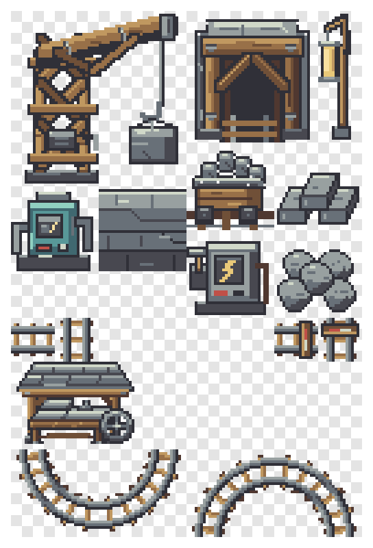

# Slateford outdoor quarry tile kit

Prepared in Aseprite from the quarry references in `docs/images/concept-art-world/`.
The layout proposal is [Slateford quarry outdoor redesign](../../docs/VIRELIA_QUARRY_OUTDOOR_REDESIGN.md).

## Files

- `source/quarry-outdoor.aseprite` holds the editable layers and 18 named slices.
- `exports/quarry-outdoor.png` is the native 128×192 indexed atlas. Index 0 is transparent.
- `manifest.json`: slice rectangles and intended gameplay roles.
- `previews/tile-kit.png`: enlarged Aseprite review image, unsuitable for packing.
- `previews/stone-props.png`: enlarged review of the rebuilt blocks and rubble.
- `previews/outdoor-layout.svg`: proposed four-section layout, not a collision render.
- `validate_art.py`: palette, transparency, source/export, slice and rail-seam checks.

## Art direction and constraints

Cool slate, warm timber, pale metal straps and amber work lamps follow the
concept's exposed quarry terraces. Pump and feed controls have different
silhouettes and symbols. The entire kit uses the existing 16-entry quarry
machinery palette in slot 7, with one transparent entry and 15 opaque colors.
All atlas colors use GBA RGB555 precision. The packed terrain uses separate
palettes for cliff faces, haul roads, sump water, rim vegetation and the
working platforms. Machinery uses slot 7 throughout.

The atlas contains a 48×32 slate cutting bench, 64×64 derrick, 48×48 timber-framed adit, 16×48 work lamp,
six 32×32 modules (cart, stone stack, pump, slate course, feed and rubble),
two 16×16 straight track modules, two buffers, and four 32×32 bends.
Each bend spans two map cells per side. Its sleepers fan around a pair of
concentric railheads on separate Aseprite layers. The upper-left light stays
fixed for every orientation so the steel joins the straight track cleanly.
Each slice starts on the 16px grid. The slate course repeats horizontally;
it is a detail overlay for a complete cliff set, not a replacement autotile set.
Rails use normal walking behavior; buffer stops and machinery are blocked.
The cart is a static freight prop in this first kit, not a rideable vehicle.

The yard's cutting bench has separate editable layers for the timber frame,
clamped slab, iron flywheel and sloping roof. Its open sides let the operator
work the stone between the sorting piles.

The cut blocks and rubble are assembled from separate, ordered Aseprite layers.
Within each ground tier, draw left to right and back to front; add the upper
tier last. The blocks have deeper visible top faces and short vertical faces.
Their upper block rests across the two base blocks at the shared support
plane. The rubble uses four ground stones and one central upper stone, with
front stones covering the bases of the rear stones. `manifest.json` records
each piece's local origin and painter order so the arrangement stays editable.

For packing, separate the derrick/lamp bases from their upper overhangs so
actors can pass behind them. Keep the suspended load off the walking route.
The boarded adits in these four outdoor sections are scenery. Keep their
frames embedded in the adjacent cliff and the working rail on its haul-road
underlay. The yard's exit to Slateford uses its own warp tile.
The runtime builder derives on/off control variants by changing indicator
index 14 to index 13. Their final IDs are generated into
`include/constants/virelia_quarry_outdoor.h`; native callbacks restore all four
metatiles of each control, including after a cached map view is loaded.

## Editing and validation

Edit at native resolution in Aseprite. Keep the source palette fixed and export
the single frame as indexed PNG with transparency. If using the drawing tools,
draw in RGB mode and convert back to indexed mode before exporting.
The PNG palette is authoritative; the tool's indexed-color statistics may
report the application palette rather than the sprite's own palette.

Run `python art/slateford_quarry_outdoor_v1/validate_art.py` after exporting.
The source and export feed `tools/virelia/build_quarry_outdoor.py`, which packs
the shared runtime bank and explicitly regenerates the four quarry sections.
Run `python tools/validate_virelia_quarry.py --self-test` for native art,
canopy layers, route gating and mutation checks. Do not run the authoring builder
over later Porymap edits unless intentionally rebuilding the quarry.
