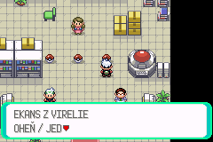
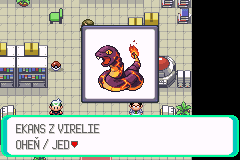
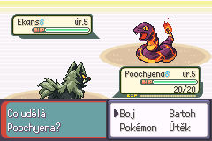

# Pokémon Virelia — My Boy! compatibility investigation

## Status and first experiment

My Boy! compatibility remains a requirement, including its future Wi-Fi Link
Cable use. No root cause or verified fix is established. No new diagnostic ROM
has yet been tested on the affected Android device. Neither acceptance criterion
(an independently verified fix or an evidence-based subsystem diagnosis) is met
by the implementation of these experiments alone.

**Test `myboy-event-only` first, followed by its matching `myboy-control`.**
The first removes laboratory starter picture creation while retaining the same
event script instructions, Czech descriptions, confirmation, selection flags, Viktor's
movement and first battle. The control retains pictures and uses the same
diagnostics. This pair asks whether the reported failure requires the skipped
picture path. A single successful run cannot answer that question.

All experimental work belongs to `codex/myboy-compatibility`, based on
`codex/virelia-first-gym`. Ordinary builds default to diagnostics off. There is
no multiplayer, map, artwork, localization, species-ID, starter-stat, save-format
or First Gym change. This investigation does not replace the evidence in
[the original freeze investigation](VIRELIA_PREVIEW_FREEZE.md),
[the prologue record](VIRELIA_PROLOGUE.md) or
[the first Gym record](VIRELIA_FIRST_GYM.md).

## 1. Exact baseline and earlier experiments

The problematic baseline is optimized release **0.3.60**, source
`4c3aeaf6c7bdf588a9ff4e69dc69c829ace74bba`, ROM SHA-256
`612318d63e787be7c9574bb6c3bc8bd5ce1a69431e37cbdcb709b4f6d376b44b`.
The archived baseline artifact was downloaded to local QA output
`outputs/myboy/baseline-0.3.60`; its ROM hash matches that identity exactly.
Its exact source revision was read. The starting branch tip `eaadd84a84` adds
documentation after that revision; its gameplay and build sources are unchanged.
Baseline 0.3.60's `copyvar` table slot was also read from the downloaded ROM:
`0x082CE8FC + 0x19 * 4` contains `0x0A223381`, as previously recorded.
Development symbols must never be used
as addresses for a differently optimized release ROM.

| Release | Exact source commit | ROM SHA-256 | Executed-path change and Android evidence |
| --- | --- | --- | --- |
| 0.3.52 | `5f72765456528cf32500be956dfa8b0fdb89c847` | `6da20d314629a94b26b1d2147ac696d9a96f4fc58b216ef3aef931b0279941a9` | Predates picture resource fixes. Clean New Game reportedly froze after the professor's sentence about Viktor's first practice battle. The tip commit itself changes documentation only. |
| 0.3.56 | `9ac6efecd8dbee7935aeeafe16f3cdb50abc3206` | `48a301b4aab67380aec0a066d08d2fbcc0cd09588983a9c5369d97ef19680147` | Includes checked picture allocations, decompression validation, task/window rollback, palette ownership and cleanup. Spinarak → B → Ekans reportedly entered a corrupt wild battle. The tip commit itself changes a test only. |
| 0.3.58 | `8f846e911b0876fe6678d13025a98a36f53a437a` | `54e21d96341b26d164c46bfb391aca4dad10fcce4a0fe2b81f23d77b4a35f29a` | Six graphics wrapper routes call five unchanged ARM kernels in immutable ROM instead of copied RAM. Freeze persisted at Ekans; a separate clean attempt froze on the first home exit, before any starter picture. |
| 0.3.60 | `4c3aeaf6c7bdf588a9ff4e69dc69c829ace74bba` | `612318d63e787be7c9574bb6c3bc8bd5ce1a69431e37cbdcb709b4f6d376b44b` | Six script/native/special dispatch sites normalize tagged ROM callbacks into primary ROM. Freeze persisted, including an attempt where My Boy!'s own controls stopped responding. |

The `.52 → .56` resource fixes change executable code; they are not merely
layout changes. The `.56 → .58` and `.58 → .60` experiments also change actual
execution, respectively kernel call targets and callback dispatch. ROM layout
changes are additional confounders, not the sole changes. Documentation-only
commits and test-only edits do not themselves alter normal gameplay execution.

Across `.52 → .60`, `src/crt0.s`, `src/main.c`, `src/dma3_manager.c`,
`src/battle_setup.c`, the laboratory scripts, callback-tag assembly macros,
script command table and special table are unchanged. The changes do not add a
different CPU core, exception handler, battle sequence or interrupt policy.

Existing evidence must remain distinct from rejected explanations:

- Real preview resource defects were fixed and regression-tested. They did not
  resolve the reported Android failures.
- Independent decoding matched all starter graphics. The captured Android state
  also retained correctly decoded Spinarak graphics. Artwork corruption and
  insufficient heap are unsupported explanations for that snapshot.
- Moving kernels to ROM did not resolve My Boy! failure. Repeating that
  relocation would not be a new decompression experiment.
- Primary-ROM callback normalization was present in the actual 0.3.60 executable
  and did not resolve failure. This is a failed compatibility comparison, not
  proof that ROM mirrors or My Boy!'s JIT caused the problem.
- A correct external BIOS and My Boy!'s BIOS emulation both failed in 1.8.0.
  Updating to 2.1.1 also failed; that later attempt's BIOS mode was unspecified.
- The same phone and ROM passed the reported previews and transition into battle
  in Lemuroid/mGBA. That comparison establishes an emulator difference for those
  steps; it does not establish a My Boy! fix or complete chapter validation.

## 2. Confirmed observations and hypotheses

| Evidence | What it establishes | What it does not establish |
| --- | --- | --- |
| Intermittent failures in New Game, without old saves | Old save data is unnecessary for those failures | The first incorrect write or instruction |
| Correct Spinarak pixels and released preview resources in the captured state | That picture decoded and its resources were released in that attempt | Absence of earlier transient corruption |
| `Task_BattleStart` active during the starter switch, corrupt battle parameters | Execution/state violated the intended laboratory path | Whether the initiating fault was dispatch, memory corruption, interrupt handling or emulator execution |
| PC in the BIOS area and invalid saved callback | The captured machine is not executing the intended laboratory flow | A reconstructed CPU trace, original exception or identified JIT defect |
| A separate failure before any preview | Starter preview creation is unnecessary for that reported attempt | Absence of other map graphics decompression or a shared engine hazard |
| Repeated CI/mGBA passes | Specified source and reference-emulator paths work | Compatibility with the affected My Boy! versions |

Graphics, callback corruption, malformed dispatch, stack damage and
interrupt/DMA timing remain hypotheses where not independently measured. The
experiments below measure boundaries rather than silently repairing a symptom.

## 3. Original crash-state analysis and its limits

The previous investigation used the real `oraculum-v0.3.58-release.st1`:
26,033 bytes, SHA-256
`87110085dd480b1e24892e2402ae9ed258b2b0675243659c8933514cd54fa865`.
Its expanded state was 527,992 bytes, SHA-256
`b063c3bdc8cdbddde5c1635fa901e16b759468de86090a08855d49c87a59a965`.
The original state was initially absent from the known QA directories. The user
then supplied `C:/Users/morav/Downloads/oraculum-v0.3.58-release.st1`; its original
and expanded hashes match those above exactly. It was reexamined read-only
against the downloaded, hash-verified **0.3.58** ROM. The observations below were
reconfirmed from actual bytes. The BIOS file itself remains unavailable in this
session; the earlier comparison with its instructions is preserved as earlier
evidence. No instruction trace is reconstructed.

The expanded file begins with `GBASTATE`, followed by big-endian version 4.
The register words at file offset `0x20` and CPSR at `0x60` reproduce the earlier
PC/SP/CPSR values. IWRAM begins at expanded offset `0xB8` and EWRAM at `0x80B8`;
these mappings were checked against actual ROM code, script structures and heap
links, rather than copied from a different emulator's format.

| Recorded location/state | Recorded value and interpretation |
| --- | --- |
| CPU PC / SP / CPSR | `0x00000068` / `0x03007FF0` / `0x600000DF` |
| CPSR fields | System mode (`M=0x1F`), ARM state (`T=0`), IRQ and FIQ disabled (`I=F=1`). This describes capture time, not necessarily the originating exception. |
| Global script context | `0x03000C88`, BYTECODE, empty stack, `scriptPtr=0x083BFC9D`; the preceding bytes encode `copyvar VAR_0x8000, VAR_0x8004`. |
| Source and destination variable | `VAR_0x8004=2` (Fire), `VAR_0x8000=0`. `copyvar` advances its pointer while reading operands before its final store; the advanced pointer does not prove the command returned. |
| Deferred native pointer | `0x0813C181`, `IsFreezePlayerFinished`; BYTECODE mode means this retained pointer was not then being called. |
| Battle task | Active `Task_BattleStart`, state 0, transition 9 (`B_TRANSITION_WHITE_BARS_FADE`). |
| Corrupt battle fields | `gBattleTypeFlags` at `0x020000B4` and `gMain.savedCallback` at `0x030023F8` both contain `0x23682368`. The saved callback is outside executable game memory. |
| Battle party | Trainer parameters zero; neither enemy team's six slots has `hasSpecies`. This is not correctly prepared battle state. |
| Heap | Six linked blocks covering `HEAP_SIZE`, 11,648 live bytes, 104,224 bytes in one free block; all eight PicData entries zero. |
| Graphics | All 4,096 Spinarak front-picture bytes at `0x02004EB4` match the source pixels; SMOL data pointer `0x0856155C` points into that picture's compressed data. |

The new analysis also compares the complete 2,176-byte initialized IWRAM image
at `0x03000000..0x0300087F` against the exact ROM image at file offset
`0x019B4330`: **zero mismatches**. This includes the IRQ dispatcher. The IRQ
vector at `0x03007FFC` is `0x03000020`, the correct dispatcher address. Thirteen
of fourteen interrupt-table slots match the ROM template; the Timer2 slot is
consistent with the engine's normal flash-timer installation. This snapshot
does not show persistent corruption of that code or vector, and does not rule
out an earlier transient or timing fault.

The serialized MMIO block at expanded offset `0x608B8` contains IE=`0x0005`,
IF=`0x0005`, IME=`0x0001`, WAITCNT=`0x40B7`. IME being enabled is distinct from
the CPU's masked IRQ bit. The final DMA3 register values describe a disabled
transfer from `0x08D59F2C` to VRAM `0x06003E00`; they do not show a malformed
current RAM destination. OAM and palette offsets preceding this block were
cross-checked against their corresponding RAM buffers. These registers retain
no DMA or interrupt timing history. A retained `0x0800030C` matches the exact
ROM's return site after `swi 5`; its presence alone does not establish the
originating exception or the last executed SWI.

The old audit compared the supplied BIOS instructions at `0x1C` and `0x68`
with its reset/reserved-handler loop. PC, SP and the BIOS stack supported an
unexpected control transfer into that loop. They do not identify the initiating
branch, SWI, IRQ or overwrite. Additional header words are retained as raw data
unless their meaning is independently established; they are not assigned an
invented banked-register history. The first-home-exit failure was a separate
report and is not represented
by this laboratory state.

The stale stack contains `0x083BFC99` at `0x03007C58` (inside `copyvar`'s
operands), `0x02021BF0` at `0x03007C5C` (its destination), `0x23682368` at
`0x03007C60/64`, a battle-start call-site return address `0x0822B1FF` at
`0x03007C68`, and the interpreter dispatch return address `0x0822A251` at
`0x03007C78`. Matching disassembly confirms these call sites. These are stack
residues, **not a validated unwind or ordered trace**. The repeated corrupt
word is absent from the exact 32 MiB ROM. Its resemblance to the low half of
an ordinary pointer literal is insufficient to identify an initiating fault.
The analysis outputs and disassembly are retained locally under
`outputs/myboy/original-state-*`; the user's original was not changed.

## 4. Relevant source and assembly evidence

The exact 0.3.60 script callback table at `0x082CE8FC` stores `copyvar` as
`0x0A223381`. Effect metadata adds `ROM_SIZE=0x02000000` to function pointers;
bit 0 retains Thumb state. `Script_GetExecutableAddress` maps only
`0x0A000000..0x0BFFFFFF` back to primary ROM and leaves RAM callbacks unchanged.
Effect analysis examines the original tag before normalization. The earlier
release audit verified the range check, subtraction and indirect calls at all
six sites; the failed Android result cannot be attributed to their omission.

Relevant baseline code locations, identified by symbol rather than assuming
identical addresses in a diagnostic ROM:

| Path | Mechanism reviewed / diagnostic boundary |
| --- | --- |
| `src/script.c`: `RunScriptCommand`, `RunScriptImmediatelyUntilEffect_InternalLoop` | Reads opcode, resolves callback, normalizes it, calls indirectly. Diagnostics validate context, table span, opcode and executable-address range before dispatch. Effect-look-ahead events are distinguished from ordinary execution. |
| `src/scrcmd.c`: `special`, `specialvar`, `callnative`, `gotonative`, `copyvar` | Table index and function-pointer integrity matter. `copyvar`'s operand reads precede its final write. A last opcode is a boundary marker, not proof that every instruction inside its handler completed. |
| `src/script_menu.c` → `src/field_effect.c` → `src/trainer_pokemon_sprites.c` | Picture task, window, sprite, frames and palette lifecycle. Existing capacity checks and rollback remain; diagnostics record requests, results, cleanup and resource counts. |
| `src/decompress.c`: `DecodeLOtANS`, `DecodeSymDeltatANS`, `DecodeInstructionsIwram`, `FastLZ77UnCompWram` | Existing ARM wrappers call unchanged ROM kernels. Source review found no demonstrated incorrect state-bit manipulation; the previous exact-binary audit remains the assembly evidence. |
| `src/crt0.s`: `IntrMain` | Saves SPSR and registers on the IRQ stack, selects an interrupt, switches to System mode, calls a `gIntrTable` entry through `bx r0`, restores IRQ-mode state/IE/IME/SPSR and returns to the BIOS wrapper. No new IRQ rewrite is introduced. |
| `src/main.c`: callback setters/call sites, `VBlankIntr` | Aligned callback writes and indirect invocation; VBlank processes graphics DMA and audio. Main-thread hooks observe selected callback installations and invocations. IRQ callbacks are not logged by this ring. |
| `src/battle_setup.c`: `CreateBattleStartTask`, `Task_BattleStart` | Logs the actual transition, task state, flags and saved callback before continuing. Enemy trainer parties may legitimately be populated later, so an empty party alone is not rejected at task creation. |
| `src/dma3_manager.c` | Fixed 128-request queue, volatile lock, VBlank budget and source/destination/size/mode records. No measured DMA timing failure is established. |

For context, `crt0.s` initializes the System stack at `0x03007E40` and the IRQ
stack at `0x03007FA0`. The recorded `0x03007FF0` is different. A sample of the
unchanged interrupt wrapper is:

```asm
mrs r0, spsr
stmfd sp!, {r0-r3,lr}
@ ... switch to System mode, select gIntrTable entry ...
bx r0
@ ... restore IRQ mode, saved registers, IE and IME ...
msr spsr_cf, r0
bx lr
```

ARM documents automatic ARM-state exception entry, CPSR mode/interrupt bits and
state switching through BX. These rules support interpreting the captured
registers; they do not identify a fault in My Boy!.
See [ARM7TDMI Technical Reference Manual, sections 2.7–2.8](https://documentation-service.arm.com/static/5f4786a179ff4c392c0ff819?token=).
The effect analyzer's `intptr_t[5]` jump buffer and longjmp from a called
function match the relevant [GCC built-in restrictions](https://gcc.gnu.org/onlinedocs/gcc/Nonlocal-Gotos.html);
source review did not establish a nonlocal-jump defect.

Two source hazards merit targeted follow-up without being called the cause:

- Baseline dispatch forms a callback-table pointer before checking whether a
  corrupt opcode exceeds the table. Special indices likewise assume trusted
  bytecode. Diagnostic validation must occur before the affected lookup, not
  merely after an indirect call fails.
- `ClearToTransparentAndRemoveWindow` queues `COPYWIN_FULL` and immediately
  removes the window. Its queued DMA source can therefore refer to released
  pixel memory. The destination is VRAM; this peripheral lifetime hazard alone
  does not explain the captured battle globals or invalid saved callback. No
  broad engine change is justified by that observation.

## 5. Diagnostic ROM variants

| Build | Configuration | Single question / expected behavior |
| --- | --- | --- |
| Ordinary release | `MYBOY_DIAGNOSTIC_MODE=0` (default) | Original behavior; no diagnostic buffer, hooks or picture suppression. |
| `myboy-control` | Mode `1`, optimized Emerald story | Does the known failure still reproduce with diagnostics and pictures intact? Original pictures, Czech selection and battle remain. |
| `myboy-event-only` | Mode `2`, optimized Emerald story | Does failure require laboratory starter picture creation? Existing Czech descriptions and YES/NO choice remain; no starter picture is created there. |

Modes 1 and 2 include variant D instrumentation. Mode 2 implements variant A
by consuming the existing `showmonpic` arguments and omitting its side effect
only for the three regional starters in the research laboratory. Its unchanged
`hidemonpic` finds no picture task and installs no wait. The laboratory script
source, opcodes, branching, callbacks for other operations and all ordinary
battle graphics remain unchanged. Linked address operands can relocate with
the changed ROM layout; raw byte identity between variants is not claimed.
Other species/maps retain picture handling.

Variants B (isolated graphics NPC/map) and C (conventional decoder) are deferred
until the first paired results. A separate pre-preview failure is already
reported, and kernel relocation already failed. Adding a new map would expand
the test surface before necessity is established. A future C must replace the
accelerated implementation with independently checked conventional decoding;
relocating the same kernels again would not test that hypothesis.

The Makefile rejects unsupported mode values, non-Emerald diagnostic builds and
diagnostic development quick starts. ROM and object names differ by mode, so
switching between control, event-only and ordinary builds cannot reuse their
object directories. Mode 0 remains the ordinary pipeline default.

With the existing ARM build environment:

```sh
make -j4 release syms MYBOY_DIAGNOSTIC_MODE=2
make -j4 release syms MYBOY_DIAGNOSTIC_MODE=1
make -j4 check MYBOY_DIAGNOSTIC_MODE=2
make -j4 check MYBOY_DIAGNOSTIC_MODE=1
```

[The isolated workflow](../.github/workflows/myboy-diagnostics.yml) builds both
variants on pushes to the compatibility branch. Its manual `variant` input
selects `event-only`, `control` or `both`. Each job runs the Python recovery-tool
regressions, creates an optimized ROM with matching ELF/map/symbols and runs the
full native suite for that mode. The normal full GitHub Actions pipeline retains
Emerald normal/release, story/development tests, FireRed, LeafGreen and docs.

Each downloadable `myboy-<variant>-<source-sha>` artifact contains `manifest.json`
and `SHA256SUMS`, the clearly named ROM, matching ELF/map/symbols, build/test logs
and this procedure. The manifest records exact source commit, build settings,
toolchain, ROM hash, hypothesis and expected behavior. Use these exact files
together; a development ELF is unsuitable for decoding a release's addresses.

## 6. Runtime diagnostics and recovery

`include/myboy_diag.h` specifies ABI version 1. `src/myboy_diag.c` owns a
linker-allocated, initialized **1,624-byte EWRAM object**, outside ordinary save
structures and the heap. It is not a guessed unused address. It contains an
88-byte header and **64 × 24-byte** event records. Compilation checks the sizes.
All fields are little-endian 32-bit integers. No allocation or FLASH write is
performed. Mode 0 removes the object and compiles hooks to no-ops.

Each record stores sequence, frame, kind, two arguments and map group/number.
Kinds cover boot, script start/opcode/return/native/special, callback changes, picture
request/create/failure/close/skip, battle-task creation/execution, faults and
resource snapshots. The opcode high bit marks effect look-ahead rather than
ordinary dispatch. Header fields preserve the latest script/opcode/callback,
preview species, battle flags, observed SP and lowest sampled SP after older
events wrap. The buffer address is obtained from the matching ELF/map.

Writes are confined to the main thread. Each record's sequence is cleared first
and committed last so recovery can reject an unfinished record. Resource scans
are bounded and occur at preview boundaries; they count free tasks, sprites,
palettes and heap bytes. The logger does not run in HBlank/VBlank or add a new
DMA. Opcode logging nevertheless changes timing and ROM/RAM layout, which is
why the paired control is required. A sampled SP is not a stack high-water mark
or proof against overflow between hooks.

Impossible contexts/opcodes, special indices, battle states/transitions,
out-of-range callbacks and invalid saved battle callbacks cause an explicit
diagnostic halt. The first fault captures IME, IE,
IF and WAITCNT, records the error and stops; pointers are not silently repaired.
Interrupts are left as they were. A static game screen can therefore be an
intentional diagnostic stop: retain its state instead of interpreting it as an
ordinary successful continuation.

The checks are range/alignment checks, not a complete executable whitelist.
They cannot identify every stale but plausible pointer, a branch into data in
otherwise valid RAM/ROM, earlier transient writes, or an IRQ/CPU failure that
occurs before a hook. The ring is event history, not an instruction trace.
Only selected main/script callback boundaries are observed; this does not
instrument every direct callback assignment or interrupt-vector write.

Recover a state made by the **same diagnostic ROM**:

```sh
python tools/myboy/decode_state.py copied-freeze.st1 > diagnostics.json
```

The recovery tool searches raw data or a complete recognized gzip/zlib stream
for the ABI signature, validates the header/record consistency and outputs
ordered events and sticky fields. Input and expanded data are bounded at
16 MiB; unknown wrappers/compression are refused. Retain the original file and
its hash. `decoded_offset` is a file/expanded-data offset, not a RAM address.
Only `--ewram-raw` with an exact uncompressed 256 KiB EWRAM dump produces an
EWRAM address. Use
the accompanying ELF/map/symbols to resolve recorded addresses. Recovery does
not establish CPU register offsets for an arbitrary My Boy! state format and
does not reconstruct preceding instructions. Run its `--help` for supported
input and output options.

There is no in-game debug screen or persistence to ordinary saves. A normal
FLASH save does not contain this buffer. Cold boot resets it. If My Boy! itself
hangs before a state can be captured, the buffer cannot be recovered through
this implementation; record the last visible step and emulator responsiveness.

## 7. Exact Android reproduction procedure

Use a separate copy of a genuine pre-selection FLASH checkpoint for each ROM,
or start New Game. Keep the same phone, emulator version, BIOS mode and speed
through each pair. Do not transfer emulator save states across different ROMs.

1. Record source SHA, workflow run, variant, ROM filename and SHA-256 from its
   manifest; independently hash the installed `.gba`. Record Samsung Galaxy J6,
   Android 9, exact My Boy! version, BIOS mode/hash and speed/render/CPU settings.
2. Cold boot `myboy-event-only` at normal speed. Complete the ordinary home
   introduction and first home exit. Note a failure here separately from lab
   failure. A new game preserves this earlier reported failure point.
3. Reach the laboratory. Examine Spinarak, read its Czech description and decline
   with B; examine Ekans and decline; examine Poochyena and decline. In event-only
   the descriptions and choice appear without pictures. No battle should start.
4. Open/decline each of the three starters twenty times. Then alternate them,
   including rapid confirmation/cancellation. Verify control returns, the windows
   close, NPCs remain present and no choice is committed by cancellation.
5. Repeat from a separate FLASH copy/new game for each starter. Select exactly
   one Pokémon, close the professor's final sentence, and separately record the
   player's movement, Viktor's pickup/movement/dialogue, battle entry, front/back
   sprites, battle outcome, return to the laboratory and healing/supplies. Test
   both a natural win and a natural loss across the runs.
6. Save through the ordinary game menu. Cold boot from FLASH only and verify
   party, map, position, progress and remaining Balls. Enter/exit home and the
   laboratory; verify map transitions and repeat interactions.
7. Repeat the same sequence with the **matching-source `myboy-control`**, unchanged
   emulator settings and a fresh copy of the checkpoint/new game. All pictures
   must now appear. Keep both failures and successful repeats in the record.
8. At a diagnostic stop/freeze, try saving the emulator state if its menu still
   responds. Record the exact last completed step, whether music continues or
   glitches, whether the emulator menu responds and whether this was the first
   or a later opening. Preserve original state, ROM manifest and a short video.
9. Change only one environment variable for the next pair: BIOS mode, then
   emulator version, then any separately requested speed/CPU setting. Test
   Lemuroid/mGBA on the same device as a reference with its result labeled
   separately. It is not a replacement for the My Boy! requirement.

## 8. Android matrix and interpretation

New results remain **NOT RUN**; there is no direct access to the affected device.
The historical results above are user reports, not new hands-on measurements.

| Galaxy J6 / Android 9 environment | Historical 0.3.60 result | Event-only | Matching control |
| --- | --- | --- | --- |
| My Boy! 1.8.0, correct external BIOS | Freeze reported | NOT RUN | NOT RUN |
| My Boy! 1.8.0, BIOS emulation | Freeze reported | NOT RUN | NOT RUN |
| My Boy! 2.1.1, correct external BIOS | Update failed; BIOS mode unspecified | NOT RUN | NOT RUN |
| My Boy! 2.1.1, BIOS emulation | Update failed; BIOS mode unspecified | NOT RUN | NOT RUN |
| Lemuroid/mGBA, same phone | Reported previews, Poochyena selection and transition into battle passed | NOT RUN | NOT RUN |

The previously supplied standard BIOS has 16,384 bytes, MD5
`a860e8c0b6d573d191e4ec7db1b1e4f6` and SHA-256
`fd2547724b505f487e6dcb29ec2ecff3af35a841a77ab2e85fd87350abd36570`.
It is not distributed with diagnostic artifacts. The ambiguous 2.1.1 report is
not evidence of separate tests of both BIOS modes.

| Paired outcome | Supported next inference/action |
| --- | --- |
| Event-only fails before any starter picture | Picture creation is unnecessary for that attempt. Preserve logs and focus on the last script/callback/map boundary. Other graphics still execute. |
| Control fails; event-only passes repeatedly | Skipped picture path or its timing/layout effects are implicated. Build a focused graphics harness or conventional decoder experiment next; do not call SMOL the cause yet. |
| Both fail at the same boundary | Compare ring events and first fault; the shared event/engine path deserves priority. |
| Both pass repeatedly | Instrumentation/layout/timing may have changed reproduction. No subsystem has yet been isolated; retain the original 0.3.60 failure as a separate control. |
| Invalid callback/opcode is captured | Confirms an integrity violation before the diagnostic halt; use preceding events and exact assembly to target the writer/transition. Does not prove its origin. |
| Emulator becomes unresponsive; no state available | Capture limit remains. A video/last completed step can classify the stage but cannot replace missing memory evidence. |

For every test, append one result row containing date, source SHA, ROM SHA-256,
variant/settings, checkpoint or New Game, repetition count, exact last step,
expected/observed behavior, state/video hash and whether the hypothesis was
supported, rejected or remains unresolved. Do not replace failed rows with later
passes or collapse different emulator/BIOS combinations into one result.

## 9. Automated regression and build evidence

Retain all baseline tests, particularly `test/script_rom_mirror.c`,
`test/pokemon_pic_preview.c`, `test/pic_sprite.c`,
`test/pokemon_pic_decompress.c`, `test/compression/smol.c`,
`test/battle/virelia_preview_graphics.c` and the prologue/First Gym event and
FLASH suites. The original investigation records exact historical results and
known failures; none is reclassified as an Android pass here.

`test/myboy_event_only.c` adds direct native checks for repeated skipped
starter pictures, operand consumption, unchanged selection result, absence of
picture resources/native waits and retained picture behavior outside the
target species/map. Diagnostic validation and recovery tools require their
own targeted regression checks. Existing event suites remain responsible for
gift/flags/movement/battle-return and FLASH behavior; Android manual steps above
cover rendered interaction and actual affected-emulator execution.

### Current-build evidence ledger

Build hashes and results below come from the exact workflow artifacts. Both
diagnostics use source `560ae9317524d1c419bfc0803001db4d75a61448`, optimized
Emerald story, GCC 13.2.1, binutils 2.42, LTO enabled. Every downloaded ROM,
ELF, map and symbol file was independently checked against its manifest hash.

| Evidence | Current status |
| --- | --- |
| Compatibility source commit / workflow URLs | `560ae9317524d1c419bfc0803001db4d75a61448`; [normal CI](https://github.com/hkcmoris/romhack/actions/runs/39680969855), [diagnostic pair](https://github.com/hkcmoris/romhack/actions/runs/39680969944) |
| `myboy-event-only` ROM SHA-256 | `8cbf23e587ed9d97204f7b45f98992bcfade165fda9b278a74636615fdae4469` |
| `myboy-control` ROM SHA-256 | `8c2a22f370b3d0247f900eae428aa11b16b9f078a8e1a64283d54c8816956b33` |
| Normal full pipeline: release/development and all other jobs | All required jobs and aggregate passed. Story 5,499 / 5,947; development 5,497 / 5,945. Emerald normal/release, FireRed, LeafGreen and documentation passed. |
| Diagnostic modes 1 and 2: full native suites | Both passed. Control 5,504 / 5,952; event-only 5,506 / 5,954. All four suites retain 18 KNOWN_FAILING, 421 TO_DO and 9 EXPECT_FAILING; no new failure. |
| Recovery-tool regressions | 11 synthetic Python tests passed; not evidence of an actual My Boy! capture or Android pass |
| Source validators | World/IDs against `14a30dafeb`, lab scene, Czech prologue, First Gym, documentation index and whitespace checks passed. |
| Affected Android matrix | NOT RUN |

Download **[event-only first](https://github.com/hkcmoris/romhack/actions/runs/39680969944/artifacts/12384418802)**
and then the **[matching control](https://github.com/hkcmoris/romhack/actions/runs/39680969944/artifacts/12385662154)**.
Their ROM filenames are `oraculum-myboy-event-only-v0.3.myboy-1-release.gba`
and `oraculum-myboy-control-v0.3.myboy-1-release.gba`. Artifacts have 30-day
retention; the workflow can rebuild explicitly selected variants later.
The source commit above identifies the executable; later evidence-only
documentation commits do not change that build identity.
The procedure bundled in the artifacts is the build-time snapshot; this page
also includes the subsequent original-state reanalysis and completed QA.

The event-only release's exact map reserves `gMyBoyDiagBuffer` at `0x020209DC`,
size `0x658`, separately from `gHeap` at `0x020018C4`, size `0x1C500`, and
the save/storage objects. Its EWRAM section ends at `0x02037AF6`, inside
the hardware's `0x02040000` limit. Use each variant's own map rather than
assuming this address for a different build.

The repository is C/assembly with no npm package/scripts. Required `npm format`
and `npm lint` commands are attempted as requested; unsupported npm commands
are not successful format/lint checks. No JavaScript or new production
dependency is needed. Applicable Python validators, native build/tests and
GitHub Actions results must be recorded independently.

### Native controller comparison, 22 October 2026 (Europe/Prague)

Both exact optimized diagnostic ROMs passed the same controller sequence in
the local mGBA libretro reference core, SHA-256
`7ebe8776ff4c8a13fe279b6f87b2b97282bb0e096905da3871a425e0b8d9b22d`.
This core identity differs from the older historical QA core; those records
are retained separately. A genuine new-game pre-selection FLASH checkpoint,
SHA-256 `d3c8fbee73b94ada9476ee6d2ff039c15c6112c7bd8c10a3937787fbf5b06217`,
was created through normal play and ordinary saving, then independently
cold-booted before being copied for each ROM. No gameplay RAM, Pokemon,
story flags or battle outcomes were injected. Symbol reads used each
optimized ROM's matching symbols. Emulator states were confined to one ROM;
persistence checks restarted a fresh core from FLASH only.

| Controller check | Event-only | Control |
| --- | --- | --- |
| Spinarak → B → Ekans → B → Poochyena → B | Three Czech descriptions/choices, no pictures, party remains empty | Three correct pictures and Czech descriptions/choices, party remains empty |
| Poochyena selection and professor sentence | One starter; player and Viktor move correctly | Same progression |
| Real rival battle | Correct back Poochyena/front Ekans; natural loss and laboratory return | Same rendered species and battle return |
| Ordinary save and cold FLASH Continue | Position `(4,8)`, party count 1, all 600 party bytes preserved | Same persistence checks pass |
| Laboratory exit and reentry | Town then laboratory, party retained | Same map transition checks pass |
| Recovered buffers | 22, mode 2, fault code 0 | 22, mode 1, fault code 0 |

Randomized party bytes were compared before and after saving within each run.
The independently generated Pokemon have different personalities/IVs; this
comparison does not require the two runs to produce identical RNG results.
The respective persistence hashes are
`18b8d63472e9e36c4f768e01b908eab627cb788e45afb421e9e1c961c01f15e6`
and `9f1d6e5e5c737a831d1bfeb1cc53a9603cdeacd9e4e31a3765cb75c5a62f34b0`.
Local actions, source/ROM/core identities, states, saves, screenshots and result
JSON remain under `outputs/myboy/qa/`. Only the small screenshots below are
tracked. The native controller run used Poochyena's battle route; all-three
starter choices and repeated resource lifecycles also retain automated test
coverage. Additional manual Android routes remain in the checklist.

**These are reference-emulator results. No My Boy! Android result is inferred.**

Event-only: the original Czech description with the picture side effect omitted.



Control: the matching picture-enabled interaction.



Event-only still uses ordinary battle graphics and the real rival battle.



### Ordinary release binary comparison

The mode-0 release from source `560ae9317524d1c419bfc0803001db4d75a61448`
has SHA-256 `e93804dd925c4b2acdf55a2d9660d3dfcf37668c301f44746fd98d0d38db8116`.
It is **not byte-identical** to baseline 0.3.60. Both are 32 MiB; all 1,822
differing bytes were accounted for by the binary audit: 211 bytes in the
interworking-veneer area `0x0828DF40..0x0828E093`, and 1,611 displacement bytes
in 1,222 branches (1,217 Thumb BL, five ARM B). All changed branches resolve
through their respective veneers to the same ultimate destination and state.
Both images contain the same multiset of 41 veneer targets/state transitions.

The script callback table at `0x082CE8FC`, `copyvar` at
`0x08223380..0x08223453`, and `RunScriptCommand` at
`0x0822A2A4..0x0822A333` are byte-identical. All bytes from `0x08300000` onward
are also identical. No diagnostic signature appears in either mode-0 ROM.
This accounts for changed executable encodings rather than claiming all
differences are nonexecutable data. It does not prove timing equivalence,
My Boy! equivalence, or the particular build/LTO detail responsible for the
veneer ordering. Local audit evidence is under `outputs/myboy/`.

## 10. Root cause, proposed correction and remaining work

**Root cause: unknown. Proposed release fix: none.** The isolated diagnostic
configuration changes observability and removes one side effect for an
experiment. It is not a compatibility fix, and is not automatically enabled
in normal release builds. Source guards detect invalid state without claiming
to repair it.

The next decisive evidence is the paired event-only/control Android result,
preferably with a same-ROM save-state ring dump at the first detected violation.
If it isolates the picture path, follow with an independent graphics harness
and a genuinely conventional decoder comparison. If failure persists before
preview creation, prioritize the shared script/callback/interrupt boundary
identified by the logs. A correction then needs a specific causal mechanism,
targeted regression and independent verification on the Galaxy J6 with My Boy!.

Until those results exist, neither successful mGBA execution nor a green full
pipeline satisfies the My Boy! acceptance requirement. The stable first Gym
branch, normal saves and future Link Cable implementation remain protected.
