# Pokémon Virelia — Slateford Quarry and first Gym v0.3

## Scope and baseline

Branch: `codex/virelia-first-gym`, based directly on the clean, committed
`codex/virelia-prologue` revision `14a30dafebeba34615f9c8d1d3d42ae019b86739`.
The baseline [CI run](https://github.com/hkcmoris/romhack/actions/runs/39573968690)
passed. The source map, laboratory scene and localization validators passed
before chapter implementation. No older `main` content replaces the prologue.

The earlier native prologue evidence covers the Rocket finale, state 5 and
FLASH Continue on `ee05868`, and the Czech battle detail UI on `14a3132`.
The latest starter Ball pickup/preview and Porymap edits had source/CI coverage
but lacked a recorded native scene check at Phase 0. This is an explicit
verification gap, not evidence that those events are broken. Native checks for
this milestone are recorded below with their exact limits.

This slice adds Slateford services, two connected quarry sections, five ordinary
single battles and Mara's first Gym. The intended additional duration is
20–30 minutes; this is a design target until timed by a human player.
Viktor, starter selection and prologue progression remain unchanged.
Link Multi, Duo Adventure, network synchronization and multiplayer missions
receive no gameplay or protocol changes and remain unverified on My Boy! Wi-Fi.

## Baseline native verification

The baseline release `oraculum-v0.2.43-release.gba` from commit `14a30dafeb`
was replayed in the official native mGBA libretro core with real controller
inputs. Gameplay RAM, Pokemon, items and flags were not injected.

Verified: starter preview, B cancellation, successful Water selection, both Ball
pickups, Viktor's movement, natural rival loss and battle return/healing; both
route trainers, an Ota loss returning to mother and a successful retry; Rocket
victory, the officer and the completed finale. An ordinary in-game save at
Slateford (19, 20), map (75, 2), was loaded by a fresh core from FLASH only.
It restored the exact position, hidden Rocket, visible officer and completed
story without replay. This closes the latest prologue's recorded native gap.

The genuine transition fixture is
`outputs/emulator/baseline/completed-prologue-14a30daf.sav`,
SHA-256 `3d18fa3360199854208c2629af58d2c12d6bbe59fef7181f18b36318038ff3b2`.
Local input/evidence metadata is in `native-baseline-evidence.json` beside it.
The automated in-game clock read 0:21; it is not a human pacing measurement.

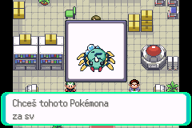
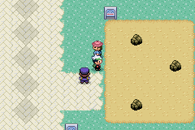

## Append-only map registry

Existing group/map, layout, species, trainer, heal location and story IDs keep
their values. New interiors append to group 76. All use the existing Slateford
map section; no world-map cell is repurposed.

| Map | Constant | Group, map | Purpose |
| --- | --- | --- | --- |
| Pokémon Center | `MAP_VIRELIA_SLATEFORD_POKEMON_CENTER` | 76, 2 | Nurse Joy, ordinary PC, save/load and whiteout |
| Poké Mart | `MAP_VIRELIA_SLATEFORD_MART` | 76, 3 | Ordinary buy/sell service |
| Slateford Quarry entrance | `MAP_VIRELIA_SLATEFORD_QUARRY_ENTRANCE` | 76, 4 | Miners, exploration and optional Super Potion |
| Slateford Quarry depths | `MAP_VIRELIA_SLATEFORD_QUARRY_DEPTHS` | 76, 5 | Both electrical controls and freight evidence |
| Slateford Gym | `MAP_VIRELIA_SLATEFORD_GYM` | 76, 6 | Geological puzzle, two trainers and Mara |

The new layouts copy Emerald tiles, palettes and existing service furnishings.
Original Hoenn maps and layouts remain intact. Existing tilesets and sprites
are reused; shared service UI graphics receive Czech labels. Layout IDs append to
`data/layouts/layouts.json`; the source validator checks their concrete order.
`tools/virelia/build_first_gym_maps.py` documents the authored layout construction.
Do not run the old world generator over later Porymap edits.

The Center appends `HEAL_LOCATION_VIRELIA_SLATEFORD_POKEMON_CENTER`.
Entering the Center records its ordinary healing/whiteout destination.
Nurse local ID is 1; whiteout position is (7, 4).
The ordinary PC uses native storage; no storage lockdown is implemented.
The upstairs communication area is closed and has no warp.
The local nurse uses the standard healing effect, party/PP/status restoration,
follower update, Pokerus explanation and normal return/bow messages. She does
not enter the shared Trainer Hill/Union Room continuation. That continuation
assumes a full Center initialized the Union Room name buffer; without it, a
native test found a 369-byte copy into the 256-byte name buffer, corrupting
font globals after healing. The local path and its call-graph regression avoid
that assumption without changing multiplayer code.
The Mart stocks Poké Ball, Potion, Super Potion, Antidote, Paralyze Heal,
Awakening, Escape Rope and Repel. Item names remain English.

## Story and chapter boundary

The completed prologue remains authoritative through
`FLAG_VIRELIA_PROLOGUE_COMPLETE` and `VAR_VIRELIA_PROLOGUE_STATE = 5`.
Entry to the new chapter sets only `FLAG_VIRELIA_CHAPTER_STARTED`.
It never clears or rewrites the prologue. The old Rocket automatic scene is
eligible only at state 4, so a completed save cannot replay it.

1. After the Rocket conclusion, the quarry manager requests help with damaged
   mining equipment. Before that conclusion, the quarry remains closed.
2. Explore two connected working areas with equipment, mineral seams, side
   paths and wild Pokémon. Bruno and Lenka offer ordinary trainer battles.
3. Restore the electrical installation by following its labeled control order.
   Operate the pump first, then the electrical feed.
   Wrong input and leaving the puzzle area reset partial input. Once restored,
   power stays restored across reentry, losses, saving and loading.
4. Inspect the abandoned freight after power is restored and both quarry
   trainers are defeated. Its label matches the grunt's discarded label.
   The stolen minerals were selected for high-capacity electrical conductors.
   The freight's destination and ultimate use remain unknown.
5. Report the evidence to the manager. The manager authorizes reopening the Gym.
   Repeated conversation grants no repeat reward.
6. In the Gym, read the geological clues, operate its two controls in order and
   defeat Ivan and Dana. The older-layer control comes before the younger-layer
   control. Then challenge Mara.
7. Win, receive the Lomový odznak and collect Rock Tomb's TM. A full Bag leaves
   the TM pending; talk to Mara again after making space. Then save and Continue.

The quarry reveals no Porygon experiments, laboratory or future Storage attack.

## Characters, battles and level curve

Mara is a geologist who works with the quarry. Her dialogue treats strata and
battle planning as practical disciplines, with occasional dry humor.
Bruno is a miner, Lenka an explorer, and Ivan and Dana train in Mara's Gym.

| Trainer | Team | Explicit moves |
| --- | --- | --- |
| Bruno | Geodude 10, Makuhita 11 | Tackle / Defense Curl / Rock Throw; Tackle / Arm Thrust / Focus Energy |
| Lenka | Sandshrew 11, Aron 12 | Scratch / Defense Curl / Sand Attack; Tackle / Harden / Metal Claw |
| Ivan | Roggenrola 13 | Tackle / Harden / Rock Throw |
| Dana | Geodude 13, Nosepass 14 | Tackle / Defense Curl / Rock Throw; Tackle / Harden / Rock Throw |
| Mara | Roggenrola 14, Nosepass 16 | Headbutt / Rock Throw / Sand Attack / Harden; Tackle / Rock Tomb / Thunder Wave / Block |

All use ordinary abilities and moves, zero fixed IVs and no held items.
AI uses Check Bad Move; Mara additionally uses Try To Faint.
No custom move, ability or damaging Ground move is added to their teams.
Losses use normal whiteout, retain earlier victories and permit retries.
Leader victory and reward collection are separate persistent states.

Trainer IDs 866–870 append after the reserved partner bank.
`MAX_TRAINERS_COUNT_EMERALD` stays 864, preserving all existing partner IDs and
the `SYSTEM_FLAGS` base. A central flag lookup maps only these five new trainers
to reserved flags 0x40–0x44. Existing trainer flags keep their original formula.
The ROM-only trainer slide table grows to cover both trainers and partners.
No save structure or link-state layout changes.

The prologue ends around levels 7–9. The entrance offers levels 8–11, depths
10–13, Gym trainers 13–14, and the leader 14/16. A small party should reach
roughly 11–17 through exploration and normal battles. The native Water run reached the Gym with Spinarak 14, Roggenrola 11 and
Sandshrew 10. No repeated experience farming was needed. Human pacing and
complete Fire/Grass combat runs remain separate checks below.

The fixed starter thresholds remain Spinarak 14, Ekans 16 and Poochyena 18.
Poochyena starts Grass/Dark and evolves to Grass/Ghost Mightyena.
Ariados's Water/Bug typing remains vulnerable to Rock attacks; evolution alone
does not remove that matchup. Fire/Poison Ekans can lower Special Defense with
Acid Spray and recruit Makuhita or Sandshrew. Trainers impose no strong Ground
attack that would exploit its quadruple weakness.

## Wild encounters

Both quarry maps use native cave land encounters with encounter rate 12.
Each row below is one native slot; its probability is unchanged by its level.

| Slot | Weight | Species | Entrance | Depths |
| --- | --- | --- | --- | --- |
| 0 | 20% | Geodude | 8–11 | 10–13 |
| 1 | 20% | Roggenrola | 8–11 | 10–13 |
| 2 | 10% | Sandshrew | 8–11 | 10–13 |
| 3 | 10% | Makuhita | 8–11 | 10–13 |
| 4 | 10% | Aron | 8–11 | 10–13 |
| 5 | 10% | Sandshrew | 8–11 | 10–13 |
| 6 | 5% | Makuhita | 8–11 | 10–13 |
| 7 | 5% | Aron | 8–11 | 10–13 |
| 8 | 4% | Geodude | 8–11 | 10–13 |
| 9 | 4% | Roggenrola | 8–11 | 10–13 |
| 10 | 1% | Nosepass | 8–11 | 10–13 |
| 11 | 1% | Nosepass | 8–11 | 10–13 |

The optional Super Potion uses its own pickup flag and retries a full Bag.
The original Whisperwood encounter table and starter learnsets remain unchanged.

## Independent progression and rewards

| Flag | Slot | Meaning |
| --- | --- | --- |
| `FLAG_VIRELIA_CHAPTER_STARTED` | 0x32 | Prologue boundary crossed |
| `FLAG_VIRELIA_QUARRY_POWER_RESTORED` | 0x33 | Quarry puzzle solved permanently |
| `FLAG_VIRELIA_QUARRY_EVIDENCE` | 0x34 | Conductive-mineral freight inspected |
| `FLAG_VIRELIA_QUARRY_COMPLETE` | 0x35 | Manager authorizes Gym |
| `FLAG_VIRELIA_GYM_PUZZLE_COMPLETE` | 0x36 | Gym puzzle solved permanently |
| `FLAG_VIRELIA_BADGE_QUARRY` | 0x37 | Lomový odznak earned |
| `FLAG_VIRELIA_TM_ROCK_TOMB_RECEIVED` | 0x38 | Rock Tomb TM actually fits in Bag |
| `FLAG_VIRELIA_ITEM_QUARRY_SUPER_POTION` | 0x39 | Optional pickup collected |
| `FLAG_VIRELIA_FIRST_GYM_COMPLETE` | 0x3A | Badge and TM collected |
| Trainer flags Bruno–Mara | 0x40–0x44 | Five independent victories |

Partial puzzle inputs use temporary vars 0x400C and 0x400D.
They are not chapter progress: leaving/reentering the puzzle map resets them.
An in-map native FLASH Continue preserved quarry stage 1 during this test.
Completed puzzle flags always restore the open passage.

The badge intentionally grants recognition and chapter progression only.
It grants no implicit Hoenn Attack bonus, obedience threshold or field-move use.
No original Hoenn badge flag is set or repurposed.
The existing eight-slot Trainer Card therefore remains unchanged.
The Gym's post-victory dialogue/statue exposes earned progress.
A future sixteen-badge page must read independent Virelia flags, present regions
separately and retain original Hoenn badge semantics.

## Czech localization

All new dialogue, control labels, acquisition messages and service UI are Czech.
Pokémon species, move, item and proper place names remain English.
The existing charmap, fonts and real-font width checks apply.
See [the extended localization audit](VIRELIA_LOCALIZATION_AUDIT.md) and the
manifest for exact species, evolution, ability, item and move coverage through
level 20. Source validation does not certify every rendered reward/service screen.

## Save compatibility

This milestone preserves existing save structure sizes and all existing IDs.
A completed baseline prologue save can enter the chapter without replaying old
events. Keep an external backup before changing ROM versions. Structural
preservation does not certify arbitrary old development saves or unrelated
configuration changes. Never load a new-map save in an older ROM lacking those IDs.

No load-time blanket initialization clears chapter flags. Rewards commit their
flag only after successful item insertion. Save/load must preserve exact map,
party, storage, money, purchases, trainer victories and story completion.

## Android starter report and preview fix

A clean New Game on Android/My Boy! release `0.3.52` was reported to freeze
after Professor Javorová says Viktor is waiting for the first practice battle.
That release predates the picture resource fixes. The same ROM passed that
point and entered the real battle in native mGBA; this does not disprove the
Android report. The branch now includes the prologue picture lifecycle fixes.
See [the investigation](VIRELIA_PREVIEW_FREEZE.md) for exact commits, checks,
remaining uncertainty and the required My Boy! test. The first corrected release `0.3.56` still failed on My Boy!: after a
Spinarak preview, examining Ekans triggered a corrupted wild battle. The next
controlled comparison runs the unchanged graphics decoder from immutable ROM.
The ROM-mode release `0.3.58` also froze on the affected device, once at Ekans
and once on the first exit from the player home, before any preview. Android
acceptance is unresolved despite both complete CI modes passing. The supplied
Android freeze-state confirms correctly decoded and released Spinarak graphics,
but corrupt battle state during the starter switch. A candidate now canonicalizes
effect-tagged script callbacks before execution; release 0.3.60 still froze at
Ekans on My Boy!, this time including the emulator UI. This is not a verified
Android fix. My Boy! 1.8.0 fails with both external and built-in BIOS; updating
to 2.1.1 also failed (BIOS mode for that attempt unspecified). On the same phone,
the same ROM passes the previews, Poochyena selection and the previously failing
transition into battle in Lemuroid. This confirms a compatibility difference,
not battle completion or a full Android chapter playtest. See the investigation
for exact evidence and remaining uncertainty.

## Validation status and manual checklist

The gameplay revision `6f3fa01bd8` passed all jobs in
[CI run 39591699117](https://github.com/hkcmoris/romhack/actions/runs/39591699117):
Emerald normal/release, story tests, development-mode tests, FireRed, LeafGreen,
documentation and the aggregate check. The story suite reported 5,471 passed
of 5,919 total; development mode reported 5,469 of 5,917. The inherited
18 known failures, 421 TODOs and 9 expected failures match the baseline;
they are not new chapter regressions. Final documentation and the additional
five-trainer native loss/retry callback regression are covered by the latest
[branch workflow](https://github.com/hkcmoris/romhack/actions?query=branch%3Acodex%2Fvirelia-first-gym).

The source validators passed against baseline `14a30dafeb`: 3,434 legacy
map/layout files and existing IDs retained, reciprocal warps, locked/open
collision graphs, trainer/reward gates, the laboratory scene and 1,059 Czech
manifest entries through level 20. Native tests load the actual city, quarry,
Gym and service map data, exercise all three starter chapter transitions,
trainer loss/retry callbacks, ordinary storage, and native FLASH save/load.
Controller tests additionally verify ordinary Mart purchases and persistence. A full TM pocket leaves the reward pending in the native test;
collecting later grants exactly one TM.

Native controller checks used release `0.3.49` from `6f3fa01bd8`, SHA-256
`6da20d314629a94b26b1d2147ac696d9a96f4fc58b216ef3aef931b0279941a9`.
The official mGBA libretro core SHA-256 was
`083acf829e6552348e6b8c80bd3414e817d86bc31d0f63de69a5af965e5a3556`.
These runs used real button inputs and genuine FLASH saves. Gameplay RAM,
party, items, experience and flags were never injected. Local savestates
accelerated work within one ROM; version changes and persistence checks
booted a fresh core from FLASH without transferring emulator state.

| Native check | Observed result |
| --- | --- |
| Completed baseline transition | Exact old position, party and completed prologue; no Rocket finale replay |
| Center | Spinarak healed from 18/27 to 27/27 HP; readable nurse follow-up and menus; in-building save and FLASH Continue |
| Ordinary PC | Naturally captured Roggenrola deposited in BOX1 and withdrawn; exact party retained after FLASH restart |
| Mart | Czech buy/sell conversation; Potion purchase and money delta persisted after an in-building save/restart |
| Quarry | Both sections, capture, optional Super Potion, Bruno and Lenka victories, wrong input, partial puzzle save/load/reset, permanent power and freight evidence |
| Whiteout/retry | Natural quarry defeat returned to Joy at Center (7, 4); earlier victories persisted and retry succeeded |
| Gym | Manager unlocked entrance; Ivan and Dana victories; partial puzzle reset on exit; solved gate persisted through healing/reentry |
| Mara | Both leader Pokemon defeated; ordinary badge/TM flags set, post-victory dialogue shown, chapter completion retained |
| Reward persistence | Repeated Mara conversation and a fresh FLASH Continue retained one Rock Tomb TM; all eight Hoenn badge flags remained false |

The party used for Mara was Spinarak 14, Roggenrola 11 and Sandshrew 10
(reaching 12 during the leader battle). Spinarak's natural level-14 evolution
had accidentally been cancelled with B during the automated capture flow;
its evolution threshold was not changed. Sandshrew used its ordinary
Defense Curl/Rollout combination. This demonstrates obtainable team support;
it does not certify human difficulty for all three starters. Failed move
selection and repeated menu inspection in this automated run are unsuitable
for a pacing measurement.

The genuine completed-chapter save is kept locally as
`outputs/emulator/completed-first-gym-6f3fa01bd8.sav`. It resumes at Gym (6, 3),
map (76, 6), with chapter flags 0x32–0x3A and trainer flags 0x40–0x44 set.
ROMs, save files and emulator dumps are untracked local QA outputs.
The following small native screenshots are tracked for review.

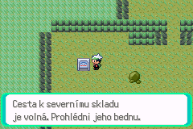
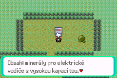
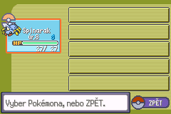
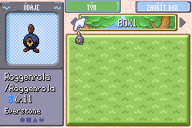
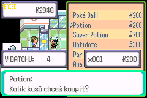
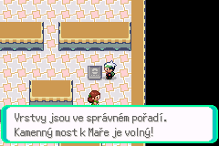
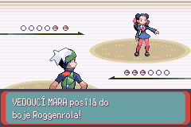
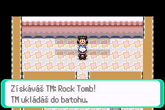
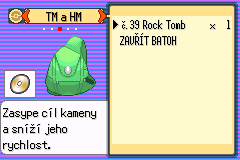

Known manual limits: the complete Fire and Grass chapter routes, every
level-up/evolution/menu branch through level 20, the badge acquisition fanfare
frame itself, human 20–30 minute pacing and Android/My Boy! have not all been
manually observed. Source width and native progression tests cover their
specified data/state paths, but do not replace those screen/device checks.

Run:

```sh
python tools/validate_virelia_world.py --base 14a30dafeb
python tools/validate_virelia_lab_scene.py
python tools/validate_virelia_prologue_text.py
python tools/validate_virelia_first_gym.py
python .github/docs_validate/inclusive_summary.py
git diff --check
make -j4 check
make -j4 check VIRELIA_DEVELOPMENT_MODE=1
make -j4 release
make firered -j4
make leafgreen -j4
```

GitHub CI retains Emerald normal/release, both test modes, FireRed, LeafGreen and
documentation jobs. Native test data assertions are not manual combat balancing.
No Android My Boy! playtest or network success is inferred from CI.

1. Back up a genuine completed-prologue FLASH save. Boot the new ROM and Continue.
   Verify exact position/party/items, hidden Rocket and visible officer, and no finale replay.
2. Also start fresh and confirm starter preview, cancellation, pickup, Viktor's
   move sequence, battle return and supplies on the latest baseline assets.
3. Enter Center/Mart; test each exit tile and save/reboot inside each building.
   Heal damaged/statused party and PP. Deposit/withdraw through the ordinary PC.
   Buy and sell items; verify money, item counts and persisted storage.
4. Lose in the quarry and Gym. Verify Center whiteout, nurse positioning, healing,
   previous trainer victories and retry. Also test loss before visiting the Center.
5. Before the prologue, verify blocked quarry; before reporting evidence, blocked Gym.
   Verify that entering/reentering an open service does not advance old story.
6. Explore both quarry paths, catch a useful teammate, beat each trainer, try
   wrong switch order, leave/reset, solve correctly, save/reboot and verify open gate.
7. Check freight before prerequisites, then after; report to manager, revisit and
   verify the Gym opens permanently.
8. Try wrong Gym controls, exit/reset, solve and defeat both trainers. Lose to
   Mara once, return and win. Verify before/after dialogue.
9. Check the Lomový odznak acquisition text and Rock Tomb TM display. Fill the TM
   pocket before victory, then free space and collect exactly once. Revisit,
   save/reboot and check no duplication. Inspect untouched Hoenn badge flags.
10. Repeat combat progression with all three starters and a modest obtainable
    team. Record team levels, captures, optional battles, healing and elapsed time.
11. Read all service, trainer, puzzle and reward text at native 240×160. Check
    diacritics and line widths, level-up moves, evolution and learning prompts
    through level 20.

Stop after the first badge and TM. No next city, second Gym, Porygon reveal,
Storage lockdown, Mega Evolution or multiplayer feature belongs to this slice.

## Optional quarry mystery: The Missing Tools

After restoring electricity, speak to the guide near the entrance at (5, 15).
He reports disappearing tools and the miners' suspicion that Team Rocket has
returned. Accept his request, collect the wrench near (7, 6), and take the
new northwest ladder at (4, 3) into the abandoned gallery.

Follow the hammer at (7, 17) and the pick at (17, 6). Small footprints, bite
marks and a preference for polished metal lead to Sableye's hoard at (24, 9).
The encounter offers **Souboj**, **Chytit** and **Později**. The first two start
an ordinary level-13 wild battle; catching uses the normal Ball, party and PC
rules. Victory or capture recovers the remaining tools. Escape, Teleport,
defeat or cancelling leaves the encounter available for another attempt.
Defeating Sableye resolves this one-time encounter, so choose capture if you
want to keep it. Both battle choices permit normal Ball use.

Return to the entrance guide for one **Hard Stone**. A full Bag leaves the
reward pending; freeing a slot and speaking again grants it exactly once.
The request, individual tools, encounter resolution and reward use persistent
flags. This optional story never advances the freight investigation or gates
Mara's Gym.

The 30 × 24 gallery appends interior map (76, 7),
`MAP_VIRELIA_SLATEFORD_QUARRY_GALLERY`. Its west ladder at (3, 20) returns to
the entrance's northwest work area. Its east ladder at (26, 20) connects to
the depths at (3, 7), near the electrical feed. Both approaches open with
electricity, independently of accepting or finishing the quest. The original
inter-section ladder remains available, creating an optional traversal loop.
Sableye and its hoard sit beside the through-route and cannot block it.
The gallery uses existing cave tiles and species overworld graphics, with
no random encounter table competing with the special encounter.

Regressions:

```sh
python3 tools/validate_virelia_missing_tools.py
python3 tools/validate_virelia_world.py
python3 tools/validate_virelia_first_gym.py
make -j10 -O all syms UNUSED_ERROR=1 DEPRECATED_ERROR=1 ROM_VERSION=0.3.0-missing-tools
make -j10 -O check UNUSED_ERROR=1 DEPRECATED_ERROR=1 ROM_VERSION=0.3.0-missing-tools TESTS=Virelia
```

The new collision validator removes the original inter-section ladder to prove
the gallery connects both work areas in both directions, with all objects
still present. Native tests cover compiled quest helpers, battle outcomes,
full-Bag retries, one-time rewards and both ladder gates. The chapter's native
FLASH save/Continue regression also retains all six quest flags and Hard Stone.
For manual testing, use a new save; check each menu choice, capture with a full
party, loss and retry, and save/reload after collecting only part of the trail.

Local validation on 2026-10-24 produced the 32 MiB development ROM
`outputs/missing-tools/oraculum-v0.3.0-missing-tools.gba` through WSL. All new
quest tests and the extended FLASH regression passed. The broader Virelia
suite passed 67 of 68 tests; the unchanged starter-balance test failed with
`Unmatched HP_BAR` in parameter 2/3. Gallery, world, first-Gym, laboratory and
documentation source checks passed. Separate sanctuary and localization audits
failed identically against unchanged Git HEAD: the sanctuary's Hana gate is
bypassable and the localization manifest lacks 156 bounded-coverage entries.
The new quarry dialogue had no glyph, width or line-count errors. These
existing audits and the starter-balance failure remain outside this quest.
`npm format` and `npm lint` were attempted; this C/Makefile repository has no
npm project or corresponding npm commands. No manual emulator walkthrough was
performed for this change.

The later Hana/localization follow-up resolves those recorded audit failures.
The starter damage test now suppresses only Water Pulse's optional confusion,
so the opponent actually uses the Rock Tomb whose damage the test measures.
It also asserts that attack's animation. No move, ability, species or damage
rules changed. All 71 Virelia native tests pass in the follow-up build.
