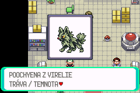
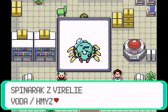
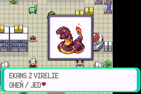
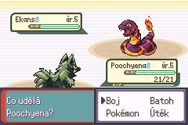
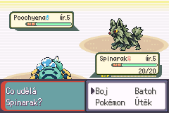

# Virelia: zamrznutí náhledu startéra na My Boy!

## Rozsah a jistota závěru

Oprava vznikla ve větvi `codex/virelia-prologue`, základ `14a30dafeb`.
Stejnou opravu přebírá navazující větev `codex/virelia-first-gym`.
Hlášený problém: stisk A u Poochyeny v laboratoři profesorky Javorové
zastaví hru na Androidu/My Boy! ještě před zobrazením obrázku či textu.
Spinarak a Ekans údajně fungují; Windows a iPhone problém údajně nemají.
Tato hlášení nejsou přímým měřením na postiženém zařízení.

Zdrojová analýza prokázala několik nezávislých chyb v obsluze prostředků.
Oprava je odstraňuje. Konkrétní příčinu Android freeze zatím nelze potvrdit:
není k dispozici postižený telefon, jeho nastavení ani diagnostický záznam.
Úspěch CI nebo mGBA nelze vydávat za úspěšný test My Boy!.

## Upřesnění Android hlášení: 0.3.52

Uživatel následně ověřil čistou novou hru v release **0.3.52**, bez savu
nebo save state. Náhled a volba Poochyeny tentokrát proběhly; hra se zastavila
po větě „Viktor už čeká na váš první cvičný souboj“. Toto místo je jiné
než původní zastavení před náhledem.

Release 0.3.52 je CI běh 39607864919, větev `codex/virelia-first-gym`,
commit `5f72765456528cf32500be956dfa8b0fdb89c847`.
SHA-256 ROM je `6da20d314629a94b26b1d2147ac696d9a96f4fc58b216ef3aef931b0279941a9`.
Toto sestavení ještě neobsahuje opravu náhledů z commitů `f1e6c8ffda`
a `656fb86e25`. Jeho laboratorní skript, pohybový engine a relevantní
konfigurace jsou shodné s prologovým základem `14a30dafeb`.

Po uvedené větě následuje `closemessage`, `hidefollower`, směrová volba
pohybu hráče, `applymovement`, `waitmovement` a Viktorův další dialog.
`OW_FOLLOWERS_ENABLED` je FALSE; po získání startéra se follower nevytváří.
Bez follower objektu skrytí pouze předá řízení dalšímu snímku. Uložený směr
se mezi zachycením a pohybem nepřepisuje. Přístupné cesty u Poochyeny
končí na volném poli (4, 8). Nezávislé dekódování původních overworld
snímků všech tří druhů také odpovídá PNG, ale tato vypnutá funkce je zde
nepoužívá.

Nové hlášení vylučuje starý save jako příčinu tohoto pokusu. Nepotvrzuje
však konkrétní chybu alokace ani úspěch připravené opravy na Androidu.
Při dalším testu je nutné zvlášť zaznamenat uzavření posledního dialogu,
pohyb hráče, Viktorův dialog a zahájení boje. Pokud se opravená ROM zastaví
ve stejném místě, bude potřeba záznam z My Boy!; mGBA tento freeze dosud
nereprodukovala.

## Cesta od skriptu ke grafice

`showmonpic` -> `ScriptMenu_ShowPokemonPic` -> `CreateMonSprite_PicBox`
-> `CreateMonPicSprite` -> `CreatePicSprite` -> `TryLoadSpecialPokePic`.
Výběr druhu, pohlaví, Unown a náhradních obrázků používá společný resolver
s původním `LoadSpecialPokePicIsEgg`. Obě přední bitmapy se dekomprimují
před vytvořením sprite, přestože náhled přes `gAnims_MonPic` ukazuje snímek 0.
Druhová animace `frontAnimFrames` se v tomto obyčejném náhledu nepoužívá.

Boj používá `HandleLoadSpecialPokePic` a stejný výběr dat/dekompresor.
Obchází však registr PicData, preview task, okno a jeho weather-paletu.
Chyby těchto náhledových prostředků proto samy o sobě nedokazují chybu
bojového sprite. Dosavadní void API a VRAM dekódování ponechávají původní
chování při nedostatku pomocné paměti; nová obnovitelná cesta patří PicSprite.

## Prokázané chyby a změny

- `CreateSprite` a `Alloc` jsou fail-fast obálky. Původní následné kontroly
  nedokázaly zachytit jejich selhání. Oba tvůrci PicSprite používají skutečné
  unchecked alokace, kontrolují sentinel a při chybě uvolní částečné prostředky.
- Původní kód mohl považovat `gSprites[MAX_SPRITES]` za živý sprite nebo
  indexovat `gSprites[0xFFFF]`. MAX_SPRITES označuje pomocný slot, který není
  platným živým sprite; 0xFFFF je mimo pole. PicBox i field-move helper nyní ověřují ID před přístupem k paletě.
  Do PicData se uloží pouze platný sprite.
- SMOL potřebuje další dočasnou alokaci až po rámech a jejich tabulce.
  `TryLoadSpecialPokePic` kontroluje hlavičku, kapacitu a zarovnání cíle;
  při nedostatku scratch paměti vrátí FALSE a umožní úklid a další pokus.
  Není to obecný validátor libovolného poškozeného komprimovaného proudu.
- Tabulky snímků měly neinicializované `relativeFrames`. Každý záznam se
  nyní nastaví výslovně. U náhledového snímku 0 jsou obě větve kopírování
  ekvivalentní; tento nález sám nevysvětluje hlášené okamžité zamrznutí.
- Při požadovaném tagu odlišném od druhu se paleta načetla pod jiným tagem.
  Nově se používá požadovaný tag, kontroluje se kapacita a rozlišuje vlastní
  a vypůjčená paleta. Sdílená paleta přežije zánik prvního PicSprite.
  Laboratorní náhled předává druhový tag, takže tento nesoulad sám jeho
  hlášené zamrznutí nevysvětluje.
- Úklid ignoruje neplatná a neaktivní ID, chrání cizí znovupoužitý sprite,
  uvolní rámce, tabulku, vlastní paletu a affine matici. Při plné tabulce
  affine matic se nepoškodí matice 0 jiného sprite.
- Preview kontroluje celou tabulku tasků: `CreateTask` při zaplnění vrací 0,
  což je zároveň platné ID. Kontroluje také WINDOW_NONE a vrací částečně
  vytvořené okno/task. AddWindow má obnovitelné alokace a při rollbacku
  odstraní i vlastní BG tilemap pointer.
- Okamžité `hidemonpic` dříve mohlo přejít ze stavu 0 do čekajícího stavu 1
  a čekat navždy. Opakované volání mohlo přeskočit uvolnění sprite.
  Skrytí nyní nastaví úklidový stav idempotentně. Po neúspěšném show není
  instalováno čekání na neexistující task; skript pokračuje bez obrázku.

Save formát, druhová ID, artwork, palety, české texty, výběr startéra,
příběh a Link Multi kód se nemění. Metadata PicData jsou pouze dočasná RAM.

## Porovnání grafiky

Analyzovaná původní ROM: release 0.2.43, commit `14a30dafeb`.
Všechna data jsou zarovnaná na čtyři bajty. Přední PNG mají 64 x 128 pixelů,
dva snímky 64 x 64, indexovaný režim a 16 barev. `anim_front.png` je přesné
spojení front a front_2; normální i shiny palety mají 16 platných barev.
Registrace odkazuje na vlastní data všech tří druhů.

| Druh | Front: komprimovaná / rozbalená velikost | Back | SMOL scratch pro front |
| --- | --- | --- | --- |
| Poochyena Virelia | 1332 / 4096 B | 720 / 2048 B | 1728 B |
| Spinarak Virelia | 940 / 4096 B | 496 / 2048 B | 1352 B |
| Ekans Virelia | 1608 / 4096 B | 744 / 2048 B | 2056 B |

Všechny tři fronty používají SMOL režim 6. Nezávislé dekódování skutečných
ROM dat ověřilo délky, zpětné odkazy, hranice bitstreamu a přesnou shodu
výstupu se zdrojovými pixely. Poochyena tedy nemá největší scratch ani
odlišný kompresní režim. Není prokázaný důvod měnit artwork nebo kompresi.

SMOL i rychlé LZ77 kopírují ARM instrukce do pracovní paměti a vykonávají je.
Neshoda s dynamickou rekompilací emulátoru je pouze hypotéza, nikoli potvrzená
příčina ani tvrzení o známé chybě konkrétní verze My Boy!.

## Nativně ověřené chování

Ověření proběhlo v oficiálním mGBA libretro na Windows, skutečnými stisky
ovladače. Test nepřidával Pokémony, příznaky, předměty ani zkušenosti do RAM.
Použil novou hru a skutečný FLASH save před výběrem startéra. Mezi různými
ROM se nepřenášel save state.

Původní release 0.2.43 také zobrazil Poochyenu správně. Hlášený Android freeze
se tedy v tomto prostředí nepodařilo reprodukovat. Opravené release 0.2.53
a finální 0.2.54 jsou byte po bytu shodné; jejich SHA-256 je
`1086757b7a4abc6f539e73767921c9a96538a425597cb83efd50e16162cc34c0`.
Gameplay kód odpovídá commitu `656fb86e25`.

Prošly všechny tři náhledy s českým popisem a jejich odmítnutí přes B.
Každý startér prošel dvaceti dalšími otevřeními a odmítnutími, celkem 60.
Při každém otevření se porovnal výřez vykresleného sprite s prvním nativním
snímkem; pixely se shodovaly. Poté skutečná volba Poochyeny spustila první
souboj, vykreslila její zadní bitmapu a po přirozené porážce vrátila hráče
do laboratoře. Samostatné čisté načtení předvýběrového FLASH savu a volba
Spinaraka ověřily soupeřovu přední Poochyenu v běžném souboji.

Běžné uložení po prvním souboji a nové spuštění finální ROM zachovaly mapu
(76, 0), pozici (4, 8), příběhový stav 3, travní volbu a jednoho Pokémona.
Hash uložených dat celého týmu byl před a po načtení totožný.
Nativní výsledky potvrzují tyto cesty v mGBA; neprokazují úspěch My Boy!.

## Regresní pokrytí

- `test/pokemon_pic_preview.c`: skutečné vyčerpání tasků, oken, spritů,
  palet a heapu; rollback BG pointeru; 120 cyklů všech tří startérů;
  okamžité a opakované skrytí a skutečný `ScrCmd_hidemonpic` po selhání.
- `test/pic_sprite.c`: regular/affine, front/back, normální/shiny, vlastní
  i vypůjčené palety, plné PicData/OBJ tiles/OAM matice, neplatná ID,
  otrávený znovupoužitý heap a selhání každé ze tří alokací s retry.
- `test/pokemon_pic_decompress.c`: hashe obou předních snímků i zadních
  bitmap proti nezávislým zdrojovým datům, všechny palety, canary hranice,
  krátký/NULL/nezarovnaný cíl a SMOL scratch OOM.
- `test/battle/virelia_preview_graphics.c`: běžný bojový engine načte každého
  startéra současně na straně hráče i soupeře a dokončí tah s poškozením.

Existující CI nadále sestavuje Emerald, release, FireRed i LeafGreen,
spouští příběhové a vývojové testy včetně původních regresí a kontrolu dokumentace.
Výsledek pro dodaný commit ověřuje
[workflow větve](https://github.com/hkcmoris/romhack/actions?query=branch%3Acodex%2Fvirelia-prologue).
Konkrétní build, hash ROM a nativní výsledky patří také do předávacího přehledu.

## Přesný test na My Boy!

1. Zálohuj běžný herní save i stavy emulátoru. Zaznamenej model telefonu,
   Android, přesnou verzi My Boy!, BIOS, nastavení vykreslování a případné
   volby CPU. Zaznamenej název a SHA-256 testované ROM.
2. Použij finální release ROM z tohoto commitu. Spusť ji úplně znovu.
   Pokračuj z kopie běžného herního savu před výběrem startéra, nebo založ
   novou hru. Nenačítej save state vytvořený starší ROM. Obnovený stav by
   mohl zachovat staré tasky, pointery či dekódovaný kód místo čistého testu.
3. V laboratoři u Poochyeny stiskni A jednou, bez turba a rychlého přetáčení.
   Musí se objevit správný obrázek a český popis. Zruš volbu přes B/NE.
   Musí zmizet okno a hráč se musí znovu pohybovat.
4. Otevři a zruš stejný náhled dvacetkrát. Potom střídavě otevři Poochyenu,
   Spinaraka a Ekanse. Zkus i rychlé potvrzení a zrušení. Nesmí přibývat
   zamrzání, chybné palety, zbytky okna ani mizet okolní postavy.
5. Na samostatné kopii savu vyber Poochyenu, ověř zisk jediného Pokémona,
   odchod Viktora a první souboj. Zadní bojový sprite musí být správný.
   S vodním startérem ověř také soupeřovu Poochyenu v prvním souboji;
   tím se zvlášť otestuje její přední bojový sprite.
6. Ulož přes herní nabídku, ukonči emulaci a znovu načti běžný save.
   Ověř tým, pozici a postup. Stejný test proveď pro původně používané
   nastavení emulátoru; případné změny nastavuj jednotlivě a přesně je zapiš.
7. Pokud freeze trvá, uveď poslední dokončený krok, zda selže první nebo
   až další otevření, zda problém nastane i v boji a zda jej vyvolá nová hra.
   Přilož hash ROM, výše uvedené nastavení a krátké video. Save před problémem
   pomůže odlišit stav hry od rozdílu emulátoru. Samotný freeze neprokazuje
   neúspěšnou alokaci ani chybu artworku.
