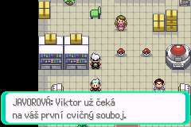
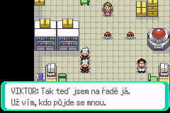
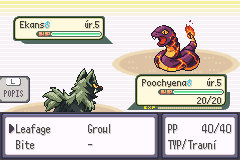

# Virelia: Android zamrznutí náhledu a přechodu k Viktorovi

## Rozsah a jistota závěru

Oprava vznikla ve větvi `codex/virelia-prologue`, základ `14a30dafeb`.
Stejnou opravu přebírá navazující větev `codex/virelia-first-gym`.
Hlášený problém: stisk A u Poochyeny v laboratoři profesorky Javorové
zastaví hru na Androidu/My Boy! ještě před zobrazením obrázku či textu.
Spinarak a Ekans údajně fungují; Windows a iPhone problém údajně nemají.
Tato hlášení nejsou přímým měřením na postiženém zařízení.

Zdrojová analýza prokázala několik nezávislých chyb v obsluze prostředků.
Oprava je odstraňuje. Konkrétní příčinu Android freeze zatím nelze potvrdit:
není k dispozici postižený telefon, jeho nastavení ani diagnostický záznam.
Úspěch CI nebo mGBA nelze vydávat za úspěšný test My Boy!.

## Upřesnění Android hlášení: 0.3.52

Uživatel následně ověřil čistou novou hru v release **0.3.52**, bez savu
nebo save state. Náhled a volba Poochyeny tentokrát proběhly; hra se zastavila
po větě „Viktor už čeká na váš první cvičný souboj“. Toto místo je jiné
než původní zastavení před náhledem.

Release 0.3.52 je CI běh 39607864919, větev `codex/virelia-first-gym`,
commit `5f72765456528cf32500be956dfa8b0fdb89c847`.
SHA-256 ROM je `6da20d314629a94b26b1d2147ac696d9a96f4fc58b216ef3aef931b0279941a9`.
Toto sestavení ještě neobsahuje opravu náhledů z commitů `f1e6c8ffda`
a `656fb86e25`. Jeho laboratorní skript, pohybový engine a relevantní
konfigurace jsou shodné s prologovým základem `14a30dafeb`.

Po uvedené větě následuje `closemessage`, `hidefollower`, směrová volba
pohybu hráče, `applymovement`, `waitmovement` a Viktorův další dialog.
`OW_FOLLOWERS_ENABLED` je FALSE; po získání startéra se follower nevytváří.
Bez follower objektu skrytí pouze předá řízení dalšímu snímku. Uložený směr
se mezi zachycením a pohybem nepřepisuje. Přístupné cesty u Poochyeny
končí na volném poli (4, 8). Nezávislé dekódování původních overworld
snímků všech tří druhů také odpovídá PNG, ale tato vypnutá funkce je zde
nepoužívá.

Stejná ROM 0.3.52 následně prošla čistou novou hrou v mGBA na Windows,
pouze běžnými stisky ovladače. Po uvedené větě se hráč přesunul, objevil se
Viktorův další dialog a skutečný souboj vykreslil Poochyenu zezadu proti
Ekansovi. Snapshot před zavřením profesorkina dialogu měl platný heap
s největším volným blokem 104 224 B. Jde o kontrolní běh na jiném emulátoru;
neukazuje stav Androidu v okamžiku jeho zamrznutí.

Nové hlášení vylučuje starý save jako příčinu tohoto pokusu. Nepotvrzuje
však konkrétní chybu alokace ani úspěch připravené opravy na Androidu.
Při dalším testu je nutné zvlášť zaznamenat uzavření posledního dialogu,
pohyb hráče, Viktorův dialog a zahájení boje. Pokud se opravená ROM zastaví
ve stejném místě, bude potřeba záznam z My Boy!; mGBA tento freeze dosud
nereprodukovala.

## Cesta od skriptu ke grafice

`showmonpic` -> `ScriptMenu_ShowPokemonPic` -> `CreateMonSprite_PicBox`
-> `CreateMonPicSprite` -> `CreatePicSprite` -> `TryLoadSpecialPokePic`.
Výběr druhu, pohlaví, Unown a náhradních obrázků používá společný resolver
s původním `LoadSpecialPokePicIsEgg`. Obě přední bitmapy se dekomprimují
před vytvořením sprite, přestože náhled přes `gAnims_MonPic` ukazuje snímek 0.
Druhová animace `frontAnimFrames` se v tomto obyčejném náhledu nepoužívá.

Boj používá `HandleLoadSpecialPokePic` a stejný výběr dat/dekompresor.
Obchází však registr PicData, preview task, okno a jeho weather-paletu.
Chyby těchto náhledových prostředků proto samy o sobě nedokazují chybu
bojového sprite. Dosavadní void API a VRAM dekódování ponechávají původní
chování při nedostatku pomocné paměti; nová obnovitelná cesta patří PicSprite.

## Prokázané chyby a změny

- `CreateSprite` a `Alloc` jsou fail-fast obálky. Původní následné kontroly
  nedokázaly zachytit jejich selhání. Oba tvůrci PicSprite používají skutečné
  unchecked alokace, kontrolují sentinel a při chybě uvolní částečné prostředky.
- Původní kód mohl považovat `gSprites[MAX_SPRITES]` za živý sprite nebo
  indexovat `gSprites[0xFFFF]`. MAX_SPRITES označuje pomocný slot, který není
  platným živým sprite; 0xFFFF je mimo pole. PicBox i field-move helper nyní ověřují ID před přístupem k paletě.
  Do PicData se uloží pouze platný sprite.
- SMOL potřebuje další dočasnou alokaci až po rámech a jejich tabulce.
  `TryLoadSpecialPokePic` kontroluje hlavičku, kapacitu a zarovnání cíle;
  při nedostatku scratch paměti vrátí FALSE a umožní úklid a další pokus.
  Není to obecný validátor libovolného poškozeného komprimovaného proudu.
- Tabulky snímků měly neinicializované `relativeFrames`. Každý záznam se
  nyní nastaví výslovně. U náhledového snímku 0 jsou obě větve kopírování
  ekvivalentní; tento nález sám nevysvětluje hlášené okamžité zamrznutí.
- Při požadovaném tagu odlišném od druhu se paleta načetla pod jiným tagem.
  Nově se používá požadovaný tag, kontroluje se kapacita a rozlišuje vlastní
  a vypůjčená paleta. Sdílená paleta přežije zánik prvního PicSprite.
  Laboratorní náhled předává druhový tag, takže tento nesoulad sám jeho
  hlášené zamrznutí nevysvětluje.
- Úklid ignoruje neplatná a neaktivní ID, chrání cizí znovupoužitý sprite,
  uvolní rámce, tabulku, vlastní paletu a affine matici. Při plné tabulce
  affine matic se nepoškodí matice 0 jiného sprite.
- Preview kontroluje celou tabulku tasků: `CreateTask` při zaplnění vrací 0,
  což je zároveň platné ID. Kontroluje také WINDOW_NONE a vrací částečně
  vytvořené okno/task. AddWindow má obnovitelné alokace a při rollbacku
  odstraní i vlastní BG tilemap pointer.
- Okamžité `hidemonpic` dříve mohlo přejít ze stavu 0 do čekajícího stavu 1
  a čekat navždy. Opakované volání mohlo přeskočit uvolnění sprite.
  Skrytí nyní nastaví úklidový stav idempotentně. Po neúspěšném show není
  instalováno čekání na neexistující task; skript pokračuje bez obrázku.

Save formát, druhová ID, artwork, palety, české texty, výběr startéra,
příběh a Link Multi kód se nemění. Metadata PicData jsou pouze dočasná RAM.

## Porovnání grafiky

Analyzovaná původní ROM: release 0.2.43, commit `14a30dafeb`.
Všechna data jsou zarovnaná na čtyři bajty. Přední PNG mají 64 x 128 pixelů,
dva snímky 64 x 64, indexovaný režim a 16 barev. `anim_front.png` je přesné
spojení front a front_2; normální i shiny palety mají 16 platných barev.
Registrace odkazuje na vlastní data všech tří druhů.

| Druh | Front: komprimovaná / rozbalená velikost | Back | SMOL scratch pro front |
| --- | --- | --- | --- |
| Poochyena Virelia | 1332 / 4096 B | 720 / 2048 B | 1728 B |
| Spinarak Virelia | 940 / 4096 B | 496 / 2048 B | 1352 B |
| Ekans Virelia | 1608 / 4096 B | 744 / 2048 B | 2056 B |

Všechny tři fronty používají SMOL režim 6. Nezávislé dekódování skutečných
ROM dat ověřilo délky, zpětné odkazy, hranice bitstreamu a přesnou shodu
výstupu se zdrojovými pixely. Poochyena tedy nemá největší scratch ani
odlišný kompresní režim. Není prokázaný důvod měnit artwork nebo kompresi.

SMOL i rychlé LZ77 kopírují ARM instrukce do pracovní paměti a vykonávají je.
Kontrola kopírovaných ARM rutin v analyzovaném vývojovém buildu ověřila,
že jejich buffery pokrývají zaokrouhlení kopie na 32 B; největší kopie
1728 B se vešla do 1740 B. Volání skončí před zánikem stack bufferu.
Toto měření není záznam z postiženého zařízení. Neshoda s dynamickou
rekompilací emulátoru je pouze hypotéza, nikoli potvrzená příčina ani tvrzení
o známé chybě konkrétní verze My Boy!.

## Nativně ověřené chování

Ověření proběhlo v oficiálním mGBA libretro na Windows, skutečnými stisky
ovladače. Test nepřidával Pokémony, příznaky, předměty ani zkušenosti do RAM.
Použil novou hru a skutečný FLASH save před výběrem startéra. Mezi různými
ROM se nepřenášel save state.

Původní release 0.2.43 také zobrazil Poochyenu správně. Hlášený Android freeze
se tedy v tomto prostředí nepodařilo reprodukovat. Opravené release 0.2.53
a finální 0.2.54 jsou byte po bytu shodné; jejich SHA-256 je
`1086757b7a4abc6f539e73767921c9a96538a425597cb83efd50e16162cc34c0`.
Gameplay kód odpovídá commitu `656fb86e25`.

Prošly všechny tři náhledy s českým popisem a jejich odmítnutí přes B.
Každý startér prošel dvaceti dalšími otevřeními a odmítnutími, celkem 60.
Při každém otevření se porovnal výřez vykresleného sprite s prvním nativním
snímkem; pixely se shodovaly. Poté skutečná volba Poochyeny spustila první
souboj, vykreslila její zadní bitmapu a po přirozené porážce vrátila hráče
do laboratoře. Samostatné čisté načtení předvýběrového FLASH savu a volba
Spinaraka ověřily soupeřovu přední Poochyenu v běžném souboji.

Běžné uložení po prvním souboji a nové spuštění finální ROM zachovaly mapu
(76, 0), pozici (4, 8), příběhový stav 3, travní volbu a jednoho Pokémona.
Hash uložených dat celého týmu byl před a po načtení totožný.
Nativní výsledky potvrzují tyto cesty v mGBA; neprokazují úspěch My Boy!.

## Navazující sestavení s prvním Gymem: 0.3.56

Oprava je také v commitu `9ac6efecd8dbee7935aeeafe16f3cdb50abc3206`
větve `codex/virelia-first-gym`.
[Release 0.3.56](https://github.com/hkcmoris/romhack/actions/runs/39661103220/artifacts/12375320942)
má SHA-256 `48a301b4aab67380aec0a066d08d2fbcc0cd09588983a9c5369d97ef19680147`.
Prologové finální sestavení 0.2.57, commit `d5fd364a6c`, je byte po bytu
shodné s již nativně ověřenými prologovými release 0.2.53 a 0.2.54.

Release 0.3.56 prošel v mGBA další čistou novou hrou: náhledem Poochyeny,
jejím výběrem, přesnou uvedenou větou, přesunem hráče, Viktorovým dialogem
a skutečným prvním soubojem s Poochyenou zezadu. Samostatný běžný
předvýběrový save z prologu se načetl v nové ROM; náhledy Spinaraka a Ekanse
odpovídaly původním nativním pixelům. Volba Spinaraka ověřila soupeřovu
Poochyenu zepředu. Běžné uložení po prvním boji a nové spuštění pouze
z FLASH zachovaly mapu (76, 0), pozici (4, 8), stav 3, travní volbu a jediného
Pokémona. Celých 600 B uloženého týmu mělo stejný SHA-256 před i po načtení.

**Android 0.3.56: neúspěšné.** Uživatel po náhledu Spinaraka přešel
k Ekansovu Poké Ballu. Po A se místo náhledu spustil poškozený divoký boj
s prázdným sprite. Laboratorní Ekansův skript nemá žádnou cestu k divokému
boji; běžná cesta po převzetí startéra vede k trenérskému souboji s Viktorem.
Tento nový výsledek potvrzuje, že samotná oprava životního cyklu náhledu
Android problém nevyřešila. Uživatel následně potvrdil přesný postup: náhled Spinaraka odmítl přes B
před přechodem k Ekansovi. Prostředí je My Boy! 1.8.0, Android 9,
Samsung Galaxy J6. Starý save nebyl použit.

## Srovnávací změna: neměnný dekodér v ROM

`GFX_DECOMPRESS_FROM_ROM` v `include/config/general.h` zapíná pro Virelia
story i development sestavení spouštění všech grafických ARM kernelů přímo
z jejich neměnných ROM adres. Dosavadní ARM přechodové obálky zůstávají.
Změna pokrývá LO, symboly s delta kódováním i bez něj, instrukce, delta
čísla dlaždic a FastLZ77. Starý RAM režim lze výslovně zapnout nastavením
přepínače na 0 pro kontrolované porovnání; FireRed a LeafGreen jej zachovávají.

Algoritmy, komprimovaná data, obrázky, palety a příběh se nemění. Nový režim
nevytváří buffery spustitelného kódu na stacku a nepřepisuje jejich instrukce.
Provádění z ROM může být pomalejší kvůli čekání na ROM sběrnici. Změna
izoluje konkrétní rozdíl, který by mohl vadit dynamické rekompilaci emulátoru;
sama ještě nedokazuje, že příčinou je právě My Boy! JIT. Výsledek nového
Android porovnání musí být zapsán odděleně od CI a mGBA.

## Nativní kontrola ROM režimu: 0.3.58

[Release 0.3.58](https://github.com/hkcmoris/romhack/actions/runs/39664056834/artifacts/12377117401)
pochází z commitu `8f846e911b0876fe6678d13025a98a36f53a437a`.
SHA-256 je `54e21d96341b26d164c46bfb391aca4dad10fcce4a0fe2b81f23d77b4a35f29a`.
Stejná změna je v prologovém commitu `fee46712bd`.

V mGBA prošla další čistá nová hra přesně pořadím Spinarak, odmítnutí B,
Ekans; oba náhledy měly správné pixely. Poté odmítnutí Ekanse, výběr
Poochyeny, uvedená profesorkina věta, přesun hráče, Viktorův dialog a první
skutečný souboj. Další čisté spuštění z běžného předvýběrového FLASH savu
a volba Spinaraka ověřily soupeřovu přední Poochyenu. Normální save po
prvním boji a FLASH Continue zachovaly mapu (76, 0), pozici (4, 8), stav 3,
travní volbu a jediného Pokémona; celý uložený tým byl byte po bytu shodný.

Další oddělená relace s běžným FLASH checkpointem provedla dvacet otevření
a odmítnutí pro každého startéra, celkem 60. Každý vykreslený výřez přesně
odpovídal kontrolním pixelům, bez divokého boje, zamrznutí či převzetí startéra.
Krátká kontrola služeb v release 0.3.58 prošla léčením, otevřením a zavřením
Storage, dveřmi Center/Martu a čitelnými českými obchodními nabídkami.
Plná transakce a uložení služeb byly samostatně ověřeny v 0.3.56; nový krátký
test 0.3.58 sám nákup znovu neprováděl.

Binární kontrola odpovídající vývojové ROM a jejích symbolů ověřila všech
šest cest do pěti neměnných ARM kernelů v ROM, včetně správných ARM/Thumb
přechodů. Pomocník CopyFuncToIwram ani FastUnsafeCopy32 nejsou přilinkované.
Žádná z těchto cest nemá vykonatelný stack buffer. Nezávislé dekódování
skutečných dat nové ROM opět odpovídá všem předním i zadním PNG a oběma
paletám všech tří startérů. Vývojové symboly se nepoužívaly jako adresy
odlišně optimalizované release ROM.

**Android 0.3.58: neúspěšné.** Uživatel hlásil zamrznutí po stisku A u
Ekansova Poké Ballu. Další čistý pokus zamrzl už při prvním opuštění domova,
před jakýmkoli náhledem startéra. Menu My Boy! dále funguje a hudba glitchuje.
Přesun grafických kernelů do ROM tedy problém na tomto telefonu neodstranil;
nelze jej označit za opravu Androidu ani příčinu omezit na Poochyenin obrázek.
Pro pokračování je potřeba zachytit skutečný save state zmrazené emulace.

Prologové CI59 již prošlo celé. CI58 prvního Gymu prošlo celé: story 5494 / 5942 a development 5492 / 5940,
se zděděnými 18 known / 421 TODO / 9 expected v každé sadě, bez nového selhání. Nativní a CI úspěchy výše tento negativní Android výsledek nemění.

## Regresní pokrytí

- `test/pokemon_pic_preview.c`: skutečné vyčerpání tasků, oken, spritů,
  palet a heapu; rollback BG pointeru; 120 cyklů všech tří startérů;
  okamžité a opakované skrytí a skutečný `ScrCmd_hidemonpic` po selhání.
- `test/pic_sprite.c`: regular/affine, front/back, normální/shiny, vlastní
  i vypůjčené palety, plné PicData/OBJ tiles/OAM matice, neplatná ID,
  otrávený znovupoužitý heap a selhání každé ze tří alokací s retry.
- `test/pokemon_pic_decompress.c`: hashe obou předních snímků i zadních
  bitmap proti nezávislým zdrojovým datům, všechny palety, canary hranice,
  krátký/NULL/nezarovnaný cíl a SMOL scratch OOM.
- `test/battle/virelia_preview_graphics.c`: běžný bojový engine načte každého
  startéra současně na straně hráče i soupeře a dokončí tah s poškozením.

ROM režim současně využívá existující `test/compression/smol.c`: byte po
bytu porovnává nezávislé nekomprimované vzory pro SMOL režimy 0–5 ve třech
velikostech, FastLZ, původní LZ, tilesety a tilemapy do WRAM i VRAM.
[Prologové CI59](https://github.com/hkcmoris/romhack/actions/runs/39664065194)
je celé zelené včetně aggregate build. Story prošlo 5476 / 5924 a development
5482 / 5930. Oba logy potvrzují všech 107 kompresních skupin a 22 nových
skupin. Každý režim zachovává 18 KNOWN_FAILING, 421 TODO a 9 EXPECT_FAILING,
bez nového selhání. [CI58 prvního Gymu](https://github.com/hkcmoris/romhack/actions/runs/39664056834)
také prošlo celé včetně aggregate build, story 5494 / 5942 a development
5492 / 5940. Všechny čtyři sady obou větví potvrzují 22 nových a 107
kompresních skupin bez nového selhání. Android problém zůstává nevyřešený.

Existující CI nadále sestavuje Emerald, release, FireRed i LeafGreen,
spouští příběhové a vývojové testy včetně původních regresí a kontrolu dokumentace.
Výsledek pro dodaný commit ověřuje
[workflow větve](https://github.com/hkcmoris/romhack/actions?query=branch%3Acodex%2Fvirelia-prologue).
Konkrétní build, hash ROM a nativní výsledky patří také do předávacího přehledu.

## Přesný test na My Boy!

1. Zálohuj běžný herní save i stavy emulátoru. Zaznamenej model telefonu,
   Android, přesnou verzi My Boy!, BIOS, nastavení vykreslování a případné
   volby CPU. Zaznamenej název a SHA-256 testované ROM.
2. Použij finální release ROM z tohoto commitu. Spusť ji úplně znovu.
   Pokračuj z kopie běžného herního savu před výběrem startéra, nebo založ
   novou hru. Nenačítej save state vytvořený starší ROM. Obnovený stav by
   mohl zachovat staré tasky, pointery či dekódovaný kód místo čistého testu.
3. V čisté nové hře nejprve otevři Spinaraka a odmítni ho přes B.
   Přejdi k Ekansovi a stiskni A. Musí se objevit Ekansův obrázek a český
   popis, bez zahájení boje. Odmítni jej. Tím se opakuje konkrétní postup,
   který selhal v My Boy! 1.8.0 na Androidu 9 / Samsung Galaxy J6.
   Potom otevři Poochyenu. Po každém odmítnutí musí zmizet okno a hráč
   se musí znovu pohybovat. Pro první kontrolu použij běžnou rychlost;
   případný test původního rychlejšího nastavení zapiš zvlášť.
4. Otevři a zruš stejný náhled dvacetkrát. Potom střídavě otevři Poochyenu,
   Spinaraka a Ekanse. Zkus i rychlé potvrzení a zrušení. Nesmí přibývat
   zamrzání, chybné palety, zbytky okna ani mizet okolní postavy.
5. Na samostatné kopii savu nebo v další čisté hře vyber Poochyenu.
   Ověř zisk jediného Pokémona a zavři profesorkinu větu o prvním cvičném
   souboji novým stiskem A. Musí se přesunout hráč, promluvit a přesunout
   Viktor a začít trenérský souboj. Zadní bojový sprite musí být správný.
   S vodním startérem ověř také soupeřovu Poochyenu v prvním souboji;
   tím se zvlášť otestuje její přední bojový sprite.
6. Ulož přes herní nabídku, ukonči emulaci a znovu načti běžný save.
   Ověř tým, pozici a postup. Stejný test proveď pro původně používané
   nastavení emulátoru; případné změny nastavuj jednotlivě a přesně je zapiš.
7. Pokud freeze trvá, uveď poslední dokončený krok, zda selže první nebo
   až další otevření, zda problém nastane i v boji a zda jej vyvolá nová hra.
   Přilož hash ROM, výše uvedené nastavení a krátké video. Save před problémem
   pomůže odlišit stav hry od rozdílu emulátoru. Samotný freeze neprokazuje
   neúspěšnou alokaci ani chybu artworku.
