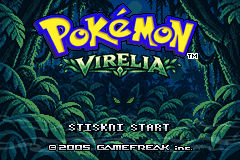
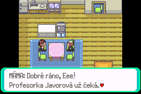
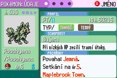
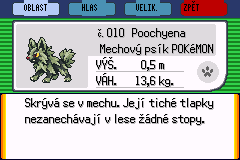
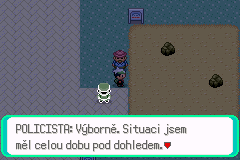
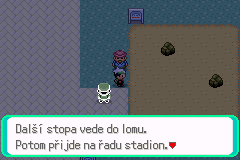
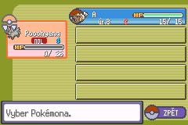
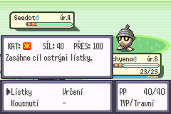
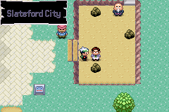

# Pokémon Virelia — playable prologue v0.2

## Scope and baseline

The [v0.3 first Gym chapter](VIRELIA_FIRST_GYM.md) continues completed prologue
saves through independent chapter flags. Its maps append to the existing registry;
the historical v0.2 scope and native evidence below remain the prologue record.

The normal Emerald new game now starts the Virelia campaign. This milestone
ends after the first Team Rocket encounter in Slateford City. It preserves the
existing title screen, species identifiers, Hoenn maps, save structures and
Link Multi implementation. No multiplayer feature is required for progression.

Branch: `codex/virelia-prologue`. The initial baseline is the last fully passing
`main` revision `6b3a90d807019edb2afed41a9882811ce09e32ff`. The subsequent
battle-message translation `198dc90ec06c83f03b5891065a96c31ff208a1a5` is integrated
as a fast-forward before the prologue commit and checked by the combined CI.

The older [world foundation](VIRELIA_WORLD.md) and
[starter prototype](VIRELIA_STARTERS.md) describe the underlying registries and
species. This document supersedes their development-start instructions.

## Playable sequence

1. Choose **NOVÁ HRA**, gender and trainer name. The engine creates the Trainer
   ID and initializes a fresh save through its ordinary new-game routines.
2. Start inside the player's house in Maplebrook Town. **MÁMA** greets the player
   automatically. She sends the player to the research laboratory and later provides
   unlimited free healing. The home also serves as the blackout destination.
3. Visit **profesorka Javorová**. Her laboratory studies adaptations to Virelia's
   ecosystems. On the first visit after meeting Mom, the player walks up the
   central aisle and stops facing the professor. After her introduction, the
   player turns toward Viktor; he approaches, mentions his tactics, and returns
   control so the player can inspect the three Poké Balls on the display table.
   Later visits skip this sequence and keep Viktor in his waiting position.
   Examining each starter Poké Ball shows that regional Pokemon's
   front sprite alongside its description and selection prompt, using the native
   picture window. Confirming or declining closes the preview; pressing B counts
   as declining and leaves all choices available.
4. Choose exactly one level-5 regional Pokémon. The normal gift-Pokémon routine
   creates its local OT, personality, IVs, normal ability, eligible moves, HP/PP,
   met location and Pokédex records. Re-entering or choosing another display
   cannot grant another starter. The chosen Ball disappears immediately after
   the successful gift; cancellation or a failed gift leaves it in place.
5. The player walks around the solid table into the open aisle. **Viktor** walks
   to the Ball with the primary type advantage, takes it, and approaches the
   player. His Ball also disappears; the unused third Ball remains. He challenges
   the player and the first battle starts immediately. Either result advances the story and
   restores the player's party. The saved result records the first outcome.
6. After either battle result, Javorová offers to name the starter using the
   native nickname screen. Declining or pressing B keeps its current name;
   finishing or cancelling the naming screen continues the scene. She then
   gives the player a Pokédex, **5 Poké Balls and 3 Potions**. This
   bundle is granted once. If either Bag pocket lacks space, the entire bundle
   waits until the player returns with space. The player can then catch wild
   Pokémon, use the party and Bag, save, heal and return home freely.
7. Follow **Whisperwood Trail** north. Battle two ordinary trainers, explore
   existing tall grass and find the optional item detour. **Hana** asks about
   her missing Zigzagoon; investigating its secluded spot reveals territorial
   behavior. Return to Hana for one extra Potion. Her thanks reveal an overgrown
   western path to the [hidden sanctuary](VIRELIA_SANCTUARY.md), with three carved
   stones, a permanent shortcut and Soothe Bell. These events are optional.
8. Reach **Slateford City**. Miners report missing conductive mineral samples.
   Investigate the suspicious maintenance worker near the mining area, expose
   his Team Rocket uniform and win a normal single battle. Losing permits a
   later retry after healing at home or the laboratory.
9. The grunt escapes and leaves a clue about the stolen minerals. A policeman
   arrives and claims progress. The completed prologue leaves all three outdoor
   areas and both interiors accessible. The quarry investigation and first Gym
   are the next objective; the Gym remains closed in this milestone.

No Hoenn moving-truck sequence, clock lesson, Birch rescue, starter selection or
catching tutorial is required. Hoenn content remains registered for future
postgame work. The Virelia initialization marks the original introduction's
progress variables so that it cannot unexpectedly restart during this campaign.

The new-game field callback also uses an ordinary fade instead of the original
truck animation. Time-based events are initialized without the clock lesson.
The equipment grant enables the engine's National Pokédex, because Natu and
Ekans are outside the inherited Hoenn listing. In story mode, entries prefer the
chosen regional starter family and the rival's actually encountered first stage;
other species keep their ordinary form. The native Pokédex shares seen/caught
bits between forms, so it cannot list ordinary and regional versions as separate
captures. A dedicated Virelia regional listing is reserved for later work.

## Maps and actors

The four existing Virelia map IDs are unchanged. The house is appended to the
interior group; existing map and layout registry entries retain their positions.

| Area | Constant | Group, map | Role |
| --- | --- | --- | --- |
| Maplebrook Town | `MAP_VIRELIA_MAPLEBROOK_TOWN` | 75, 0 | Home, laboratory, route entrance and residents |
| Whisperwood Trail | `MAP_VIRELIA_ROUTE01` | 75, 1 | Wild encounters, two trainers, item detour and optional Hana event |
| Slateford City | `MAP_VIRELIA_SLATEFORD_CITY` | 75, 2 | Mineral theft, Rocket battle, policeman and closed Gym |
| Research laboratory | `MAP_VIRELIA_MAPLEBROOK_RESEARCH_LABORATORY` | 76, 0 | Professor, assistant, three displays and Viktor |
| Player's home | `MAP_VIRELIA_MAPLEBROOK_PLAYERS_HOUSE` | 76, 1 | New-game spawn, mother and free healing |

The home uses existing Emerald house assets. Its spawn is `(5, 6)`, healing
arrival `(2, 7)`, mother local ID `1`, and its paired exit tiles are `(8, 8)` and
`(9, 8)`. The town's original laboratory warp keeps index `0`; the home entrance
is appended at `(7, 9)`. Outdoor north/south connections remain bidirectional.
The world validator checks physical walkability, reciprocal warps and that
objects have an accessible interaction tile.

New names are provisional: **Javorová** (local professor), **Viktor** (recurring
rival), **Ela** and **Ota** (route trainers), **Hana** (Zigzagoon's owner). The
mother, laboratory assistant, miners, policeman and Rocket grunt are unnamed.
The player's name always comes from the save's `{PLAYER}` placeholder.

## Starters and battles

| Player's choice | Species | Type | Viktor's level-5 Pokémon |
| --- | --- | --- | --- |
| Grass | `SPECIES_POOCHYENA_VIRELIA` | Grass/Dark | `SPECIES_EKANS_VIRELIA` |
| Water | `SPECIES_NATU_VIRELIA` | Water/Psychic | `SPECIES_POOCHYENA_VIRELIA` |
| Fire | `SPECIES_EKANS_VIRELIA` | Fire/Poison | `SPECIES_NATU_VIRELIA` |

Virelian Poochyena evolves into Grass/Ghost Virelian Mightyena at level 18,
then into Grass/Ghost Wraithena at level 38. The existing identifier and
provisional in-game name `Wraithena` are preserved. Original Hoenn Poochyena and
Mightyena retain their original types and evolution. No Forest Ambush ability
or other signature mechanic is added.

Viktor uses a deliberately restrained introductory moveset rather than an
overwhelming super-effective attack. The engine's early-rival battle mode
returns to the script and heals after either win or loss. All three teams remain
level 5; the starter choice, rather than a randomly selected team, chooses the
trainer definition.

| Trainer | Team | Persistence |
| --- | --- | --- |
| Viktor | One regional starter, level 5 | Rival-complete flag plus saved outcome |
| Ela | Wurmple 4, Zigzagoon 4 | Ordinary engine trainer-defeated flag |
| Ota | Taillow 6 | Ordinary engine trainer-defeated flag |
| Rocket grunt | Rattata 7, Zubat 6 | Ordinary trainer-defeated flag plus Rocket story flag |

The appended trainer IDs are `855`–`860`; no old trainer ID is renumbered.
Whisperwood Trail keeps its ordinary wild Pokémon and level-2–5 encounter slots:
Wurmple, Zigzagoon, Poochyena, Seedot, Taillow, Shroomish and Ralts. Regional
starters do not replace those encounters. A Potion item ball uses the existing
`FLAG_ITEM_VIRELIA_ROUTE01_POTION`.

## Saved state and idempotency

Before the stable release, discard saves from previous playtest versions and
choose **NEW GAME** whenever switching versions. Cross-version save compatibility
is not promised. Saving and loading within the current build must still preserve
Pokemon, items, position and story state correctly.

Story state uses existing unused flag/variable slots. The story initializer runs
only for a newly created game. Development and story playtests use separate new
games.

Definitions live in `include/constants/virelia_prologue.h`.

| Flag | Slot | Meaning |
| --- | --- | --- |
| `FLAG_VIRELIA_MOM_MET` | `0x21` | Home introduction complete |
| `FLAG_VIRELIA_STARTER_RECEIVED` | `0x22` | Starter grant committed |
| `FLAG_VIRELIA_RIVAL_COMPLETE` | `0x23` | First rival battle returned after win or loss |
| `FLAG_VIRELIA_ROCKET_DEFEATED` | `0x24` | Rocket battle won |
| `FLAG_VIRELIA_SUPPLIES_RECEIVED` | `0x25` | Once-only Pokédex and equipment bundle granted |
| `FLAG_VIRELIA_PROLOGUE_COMPLETE` | `0x26` | Rocket clue and conclusion resolved |
| `FLAG_VIRELIA_SIDEQUEST_STARTED` | `0x27` | Hana's request heard |
| `FLAG_VIRELIA_SIDEQUEST_RESOLVED` | `0x28` | Zigzagoon investigated |
| `FLAG_VIRELIA_SIDEQUEST_REWARDED` | `0x29` | Hana's reward granted |
| `FLAG_VIRELIA_HIDE_DEV_GUIDE` | `0x2A` | Development guide hidden in story |
| `FLAG_VIRELIA_HIDE_POLICEMAN` | `0x2B` | Policeman has not arrived yet |
| `FLAG_VIRELIA_HIDE_STORY_ACTORS` | `0x2C` | Story actors hidden in development mode |
| `FLAG_VIRELIA_MINER_REPORT` | `0x2D` | Mineral theft reported by miners |
| `FLAG_VIRELIA_PROFESSOR_MET` | `0x2E` | First laboratory explanation heard |
| `FLAG_VIRELIA_HIDE_GRASS_STARTER` | `0x2F` | Grass starter Ball taken |
| `FLAG_VIRELIA_HIDE_WATER_STARTER` | `0x30` | Water starter Ball taken |
| `FLAG_VIRELIA_HIDE_FIRE_STARTER` | `0x31` | Fire starter Ball taken |

| Variable | Slot | Values |
| --- | --- | --- |
| `VAR_VIRELIA_PROLOGUE_STATE` | `0x4083` | Home `0`, mother `1`, starter `2`, rival `3`, Rocket `4`, complete `5` |
| `VAR_VIRELIA_STARTER` | `0x408B` | Grass `0`, water `1`, fire `2`, none `0xFFFF` |
| `VAR_VIRELIA_RIVAL_RESULT` | `0x4091` | Engine battle outcome of first rival battle |

Native grant functions validate their prerequisites and return success through
`VAR_RESULT`. Flags are the authority for once-only grants; re-entering a map,
repeating dialogue, declining a choice or loading a checkpoint cannot grant
additional starters or bundles. Hana's reward flag is set only after the item
fits into the Bag. The full Bag case leaves the reward available for a retry.

The laboratory synchronizes Ball visibility before spawning its objects.
Existing pickup flags are never cleared in story mode, and completed story
states do not replay the scene. The entrance sequence records its completion
after Viktor's greeting; returning before starter selection restores his
waiting position. Development and nonstory builds retain all three exhibition
Balls.

## Czech localization

All authored story dialogue, choices, signs, trainer reactions, gifts and object
messages are Czech. Proper Pokémon names and Maplebrook Town, Whisperwood Trail,
Slateford City and Virelia remain unchanged. Move and item names retain their
English spelling in every build; their descriptions and surrounding messages
are localized. Czech dialogue inflects item names where needed (`Potiony`,
`Potionů`); quantity labels use the base name (`3× Potion`). The rival class
uses `Rival` (`RIVAL` in uppercase labels). Text reuses the existing Czech
charmap and fonts, including accented uppercase characters.

The shared resources reachable through this slice include battle messages,
menus, saving, Bag, party, summary, naming, Pokédex, relevant items, move
descriptions, abilities, types and statuses. The detailed coverage, exceptions and outstanding
visual checks are maintained in the
[localization audit](VIRELIA_LOCALIZATION_AUDIT.md). That audit is the authority
for localization status; a compiled ROM alone does not certify complete Czech
coverage or correct on-screen wrapping.

The 2026-10-24 merge-gate update resolves all 156 missing bounded-coverage
entries reported after merging the newer route data: 46 moves, 16 abilities,
15 Pokédex records and Sitrus Berry. Including generation-specific description
variants and the berry's quantity label, the manifest now contains 1,231
entries and passes `tools/validate_virelia_prologue_text.py` through level 20.
The existing coverage derivation and font limits remain in force. Move and item
names retain their English literals; Czech descriptions, ability names and
Pokédex text use the existing localization macro. Bind, Encore, Minimize, Taunt
and Sitrus Berry retain their generation guards and English test text.
The accompanying WSL build passes the full native suite: 5,512 tests passed,
with 18 marked known failures, 421 TODOs and nine expected-failure self-tests;
there were no unexpected failures. All 71 Virelia tests passed as well.

Shared battle and data strings retain English test fixtures under `TESTING`
where necessary. Localized strings in normal and release ROMs select Czech at
preprocessing time. This keeps the upstream behavior tests meaningful without duplicating either
language in a playable ROM. Development-only test notices are hidden in story.
The story Pokédex uses metres, kilograms and a decimal comma. Development mode,
FireRed/LeafGreen and upstream test fixtures retain their original unit settings.

## Build configuration

GitHub Actions compiles the ROM; no local Ubuntu, WSL or ARM toolchain is needed
to edit this Windows checkout. The default `emerald-release` artifact starts
the story. `emerald-development` is the normal unoptimized **story** build;
the artifact name describes compiler optimization, not the old quick start.

With the project's existing build environment, use:

```sh
# Normal story, also the default CI release.
make -j4 release

# Original development quick start, starter scientist and Link Multi test tools.
make -j4 VIRELIA_DEVELOPMENT_MODE=1

# Story and original development regression suites.
make -j4 check
make -j4 check VIRELIA_DEVELOPMENT_MODE=1
```

`VIRELIA_DEVELOPMENT_MODE` defaults to `0`. Mode `1` enables the original
`ORACULUM_DUO_TEST_QUICK_START`, `VIRELIA_WORLD_TEST` and `VIRELIA_STARTER_TEST`
facilities through the established configuration. It adds `-devmode` to output
names and object directories, preventing stale object reuse when switching modes.
Use distinct saves for development and story playtests. The development mode
does not modify Cable Club communication or Link Multi battle rules.

The title SELECT shortcut and built-in debug menus are also restricted to
development mode in Emerald. Both optimized and unoptimized story builds keep
those tools hidden. FireRed/LeafGreen retain their existing configuration.

CI retains Emerald, FireRed, LeafGreen, optimized release and documentation
checks. It runs story and explicit development-mode tests in separate jobs.
The prologue used ROM version `0.2.N`, where `N` is the Actions run number.
The first Gym branch advances that version to `0.3.N`.

## Validation and manual playtest

Native QA uses an official mGBA libretro core and real controller inputs at
240 × 160. It does not inject Pokémon, items or story flags. The optimized
release from commit `7c120c18eb` passed fresh female trainer creation and the
automatic home introduction within 120 frames of confirming the name. It also
loaded a genuine in-game FLASH save from the earlier story build. Save tests
restart the core from FLASH, without transferring an emulator savestate.





All three starter/rival matchups were played natively. Winning and deliberately
losing the rival both continued to healing and the initial supplies. Additional
native checks covered catching an ordinary Wurmple, both route trainers, the
optional Potion detour, Hana's once-only reward and its FLASH persistence, and
a Rocket loss returning safely to mother before winning a retry. A capture
after previously opening the full Pokédex exposed a pre-existing stale-pointer
bug: closing the menu freed `sPokedexView` without clearing it, so caught-entry
cleanup could free a live battle allocation. The cleanup now clears the pointer.
The first Rocket finale also exposed an asset configuration error: the police
sprite was registered only in FireRed/LeafGreen, so spawning it reset Emerald.
The existing police art and registry entry are now shared with Emerald, without
changing any graphics or species IDs. Native tests check the graphics pointer
for every object template on all five playable maps. The corrected capture,
nickname and next-battle sequence passed on `ee05868f53` (Actions build
`0.2.36`). The full Rocket finale passed in both unoptimized and optimized
release builds. The officer's three Czech dialogue pages lead to state 5 and
the quarry/Gym objective. The Gym stays closed; leaving Slateford and returning
does not replay the ending. A normal in-game save followed by a fresh core boot
from FLASH restored the exact Slateford position, party, items, hidden Rocket,
visible officer and completion flags. The
[localization audit](VIRELIA_LOCALIZATION_AUDIT.md) records the evidence.

The later `f52456d` native check also verified the Czech `MDL` badge after a
wild Taillow naturally fainted the starter, and the `POPIS` move-detail prompt.
The assembled statistics row has a separate font-metric check for three-digit
values and `---`, column spacing, category icon and the 144-pixel window edge.
Its numeric buffers include space for all three digits and the terminator.
Native build `14a3132` (`0.2.39`) confirmed the complete `PŘES: 100` label
without clipping, followed by closing the detail and returning from battle.







Source checks runnable without an ARM toolchain:

```sh
python tools/validate_virelia_world.py
python tools/validate_virelia_lab_scene.py
python tools/validate_virelia_prologue_text.py
python .github/docs_validate/inclusive_summary.py
git diff --check
```

The laboratory scene validator follows the actual map script and movement
commands against the map collision data. It covers both entrances, the once-only
welcome and repeat visits, every reachable side of each Ball, solid table
collision, pickup order, type advantage, dialogue, final facing, canceled or
failed gifts, and accepting or declining the post-battle naming offer. Run it
with `--self-test` to also reject representative script regressions. The
post-`0.2.40` pickup scene has source validation. The first Gym milestone also
replayed the latest `14a30dafeb` baseline natively with Water selection, preview
cancellation, both pickups, Viktor's movement and battle return. See its
[baseline evidence](VIRELIA_FIRST_GYM.md#baseline-native-verification); this does
not replace the separate fresh-run checklist for every starter.

The native suites `test/virelia_prologue.c`,
`test/virelia_prologue_events.c`, `test/virelia_world.c` and
`test/virelia_starters.c` cover initialization, prerequisites, all starter and
rival choices, duplicate prevention, types, equipment, battle continuation,
event persistence, save/load and bidirectional warps. Existing multiplayer and
development regressions run with the explicit development configuration.

Before declaring the milestone manually accepted, play a fresh release save
with **each** starter and record the ROM commit, emulator and elapsed time:

- Confirm trainer creation, Czech glyphs in both cases, spawn, the unmissable
  opening conversation with mother and repeatable free healing.
- Inspect all displays, decline once, choose once, then revisit and try all
  displays again. Check species, level, OT, moves, HP/PP and Pokédex registration.
- Choose each starter from every accessible side. Check that its Ball vanishes,
  Viktor walks to and takes the counter-type Ball, then faces the player before
  the challenge and battle. After returning and reloading, only the unused Ball
  should remain. Confirm cancellation keeps all three Balls.
- Win and lose separate rival battles; verify the expected opposing species,
  restored party, Pokédex, five Balls and three Potions without duplicate gifts.
- Catch an ordinary wild Pokémon, inspect its Pokédex entry and summary, use
  and cancel Bag actions, switch party members, heal and save.
- Battle both route trainers; check the item detour and Hana event in either
  order, including revisits and a full Bag reward retry.
- Lose once to Rocket, heal and retry. Win, read the clue and policeman scene,
  leave and return; the conclusion must not repeat and the Gym must stay closed.
- Save and reload within the same build at home, after rival, on the route and
  after Rocket. Confirm party, items, position and story/trainer flags.
- Inspect every reachable screen listed in the localization audit. Check actual
  GBA text windows for clipping, accents, substitutions and remaining English.
- Separately start a mode-1 build and check the original test facilities. Link
  Multi still requires its existing two-emulator manual verification.

The target is **15–20 minutes** at normal text speed, including one capture,
both route trainers, the optional detour and the Rocket scene. The initial
estimate allocates 4–5 minutes to creation/home/lab, 2–3 to the rival/equipment,
5–7 to route exploration/catching and 3–5 to Slateford. This is a content and
interaction estimate, **not a measured human playthrough**. A native Grass run
completed the fixed prologue at an in-game clock of **00:14:03**, including
all three starter descriptions, one selection, Hana's quest, both route trainers
and the Rocket battle, with no capture on that run. Checking the closed Gym and
returning to the city advanced the clock to **00:14:55**. This supports
the estimate for a normal journey with one capture and time to read the ending;
it does not certify human completion time. Record timed release-ROM observations
after manual verification; CI duration is not gameplay duration. Fast text,
skipped exploration or grinding can change it.

The requested `npm format` and `npm lint` commands were invoked, but this C/ASM
repository has no npm package/scripts and npm reports them as unsupported.
The repository's Python validators, native `make check` suites and GitHub
Actions are the applicable checks. No JavaScript or dependency was added.

## Slateford finale staging

The defeated worker now flees via the southern city road to (14, 29), fully
outside the fixed camera before removal. When the player approaches from the
west, he first goes around the player. The other legal approaches share the
direct route to the road. No route crosses the quarry rocks or another actor.

The policeman's hidden template is positioned at the southern entrance before
spawning. He walks up the road and across the square at normal speed (16 frames
per tile), faces the player and pauses before speaking. His stop at (20, 22)
is saved to the object template and used by the map after returning to the city.
The existing battle prerequisites and prologue completion flags are unchanged.

`python3 tools/validate_virelia_slateford_scene.py` checks all three legal
approaches against the actual map, objects, movement scripts and camera limits.
The strict development ROM and all 72 native Virelia tests passed after this
change. Focused mGBA fixtures started from a fresh initialized game, injected
the prerequisites and winning battle result, and ran the compiled post-battle
scene from the west, east and north. Frame traces confirmed the offscreen exit,
normal officer step timing, no player overlap and the final (20, 22) stop.
Returning to the city retained the officer and did not replay the scene.



## Remaining milestones

The [v0.3 milestone](VIRELIA_FIRST_GYM.md) implements the quarry and first Gym
after this prologue. Further cities, the full Rocket plot, Porygon experiments
and storage incident remain reserved for later milestones. Mega Evolution
remains locked. No new signature ability, cooperative story gate,
PvP reward, network synchronization or Duo Adventure feature is introduced.

Temporary art and names remain documented in the starter prototype. The native
engine's broader postgame, PC and multiplayer facilities are retained; their
full-game localization and manual acceptance are outside this opening slice.

## Android preview investigation

See [the preview freeze investigation](VIRELIA_PREVIEW_FREEZE.md) for checked
sprite allocation, cleanup regressions, unchanged artwork evidence, the
separate battle path and the exact My Boy! verification procedure. A successful
CI or native mGBA run does not certify the affected Android device.

The affected Galaxy J6 / Android 9 still freezes in My Boy! 1.8.0 with both
external and built-in BIOS, including the 0.3.60 candidate. The user's BIOS
matches the standard checksum. Updating My Boy! to 2.1.1 did not resolve the
freeze; the BIOS mode of that later attempt was not specified. On the same phone
the same ROM passes the previews, Poochyena selection and the previously failing
transition into battle in Lemuroid. Battle completion and the full Android
chapter remain unverified. This is a confirmed compatibility difference, not a
completed My Boy! fix; see the investigation for the captured state and native proof.
