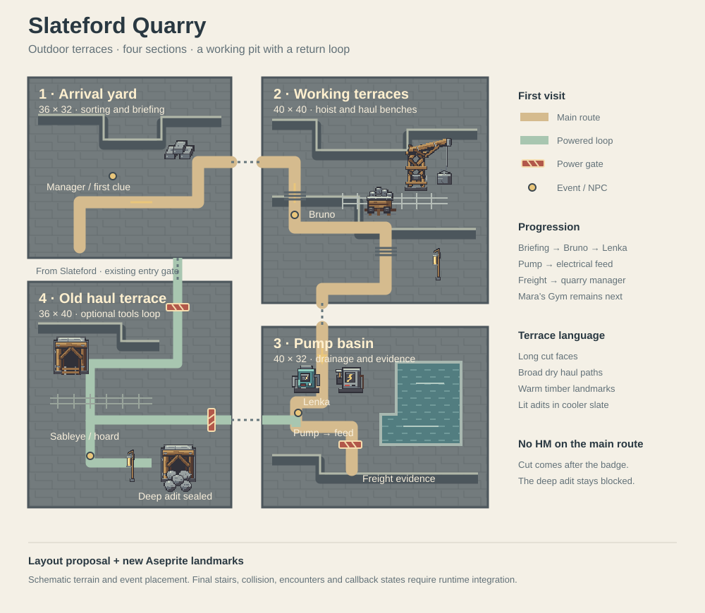
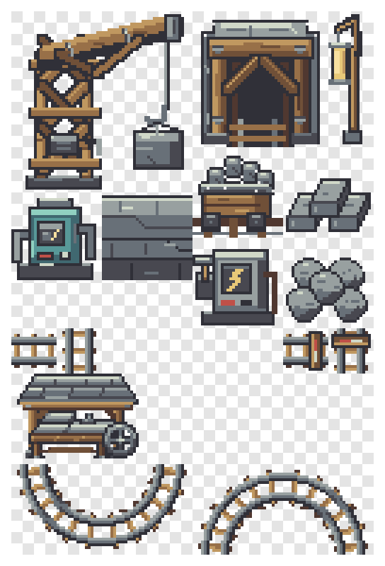
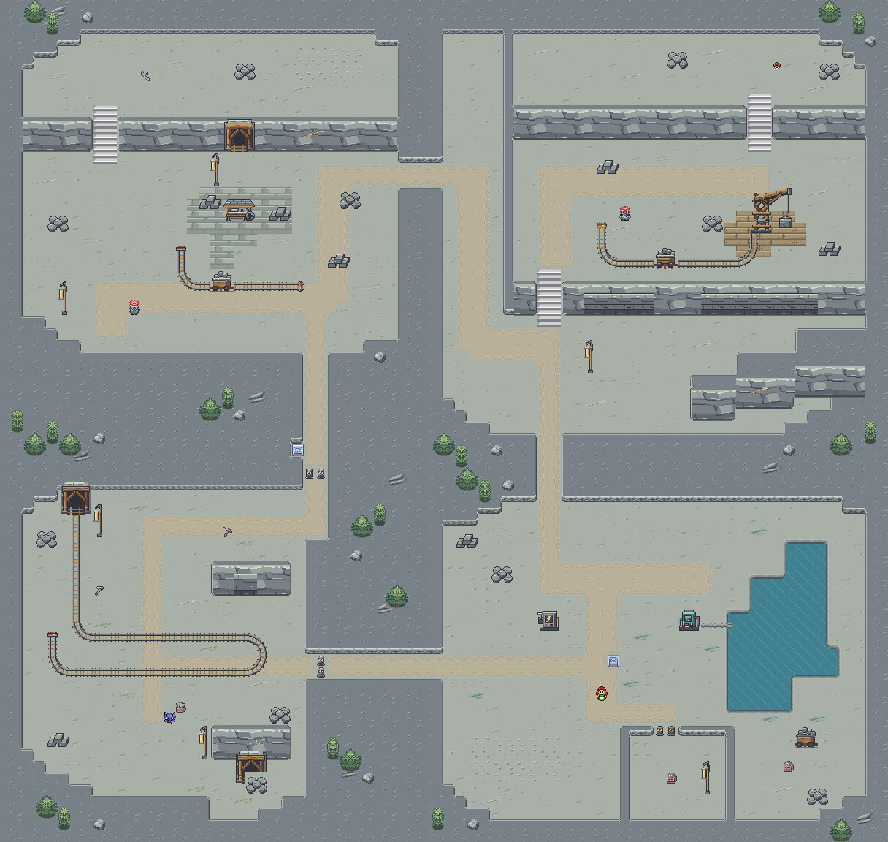

# Slateford Quarry: outdoor redesign

Status: implemented as four connected outdoor sections. The former entrance,
depths and gallery maps now serve as the arrival yard, pump basin and old haul
terrace; the working terraces are an appended outdoor map. Existing quest
helpers, trainer teams, encounter tables, item rewards and progression flags
remain authoritative. Adits are blocked scenery for future interior content.

## Concept-art reading

References: [quarry environment](images/concept-art-world/concept-quarry-rainfall-seabreak.png)
and [quarry layout](images/concept-art-world/map-quarry-rainfall-seabreak.png).
The defining features are a stepped open pit, long exposed slate faces,
timber derricks, mine-cart tracks along benches, lit adits, working sheds,
and a blocked deeper passage. Translate their vertical scale into visible
terraces and connected outdoor maps, rather than extending the existing cave.

## Four connected sections

Section sizes and seam coordinates below match the authored maps. Current
asset placements and gate coordinates are recorded in
`tools/virelia/quarry_outdoor_contract.json`.
Each section uses General as its primary tileset and the same new outdoor
quarry secondary bank. Internal seams share identical tile/palette definitions.

| Section | Size | Global origin | Identity and route |
| --- | --- | --- | --- |
| 1. Arrival yard | 36×32 | (0,0) | Quarry office frontage, sorting tables, cut-stone stacks and cart siding. Enter from Slateford near (9,29), see the large hoist across the pit, then follow the east haul road. Put the quest briefing and first tool clue here. |
| 2. Working terraces | 40×40 | (36,0) | Three exposed benches around the main derrick. Bruno guards the middle haul road; optional stairs lead to ore seams and the existing Super Potion. The main descent stays visible and at least two tiles wide. |
| 3. Pump basin | 40×32 | (36,40) | Lowest working terrace, a shallow drainage sump, pump house and electrical cabinet. Lenka and the two controls are accessible before restoration. The freight evidence sits behind the powered barrier on the dry platform. |
| 4. Old haul terrace | 36×40 | (0,32) | Quieter, partly reclaimed shelf with abandoned rails, lantern-lit adit and Sableye's hoard. After power restoration it links the basin back to the arrival yard. A rockfall seals the deeper cavern as future content. |

The clockwise first visit is yard → terraces → basin → restored freight.
Opening both old-haul barriers then creates a useful return loop and optional
tools mystery. The hoist, framed entrances and equipment are landmarks rather
than repetitive clutter. Leave open stone aprons around them for readable
NPC movement and follower spacing.

## Native seams and elevation

| Source | Direction / offset | Source seam | Destination seam | State |
| --- | --- | --- | --- | --- |
| Yard → working terraces | right / 0 | (35,14–15) | (0,14–15) | Always open after quarry entry |
| Working terraces → basin | down / 0 | (10–11,39) | (10–11,0) | Always open |
| Basin → old haul | left / −8 | (0,16–17) | (35,24–25) | Interior barrier follows power flag |
| Old haul → yard | up / 0 | (26–27,0) | (26–27,31) | Interior barrier follows power flag |

Each reverse connection uses the opposite direction and negated offset.
These offsets follow the listed global origins. Keep all seam endpoints at
elevation 3. Step through existing native stair metatiles to higher internal
benches at elevations 5 and 7; cliff faces, rails and waterfalls must not
silently change elevation. Do not introduce ladders between the outdoor maps.
The old-haul barriers sit eight tiles inside each section, so native
neighbor buffers render a stable seam. Locked vestibules may be reachable;
the Sableye/hoard area and the return shortcut must remain inaccessible.

Slateford's current quarry entrance and manager remain the external entry
contract, with a conventional reciprocal warp into the yard. The city and
quarry use different secondary banks, so do not add a direct map connection
between them. Rainfall retains its current badge-gated northern city entrance.
The distant Rainfall ridge can be a vista from the working terraces.

## Progression and event placement

- Keep the completed prologue as the quarry-entry requirement and retain the
  manager's persistent step-aside scene.
- Bruno moves to the working terraces; Lenka stays near the basin approach.
  Keep both as ordinary trainer battles and retain their existing teams.
- Put pump and electrical feed in the same basin map. The player operates
  pump first, then feed. Wrong order or leaving the basin resets partial
  input; completed power remains persistent. A clue sign is readable before
  either control, and both controls have a clear south-facing interaction tile.
- Power opens the freight barrier and both return-loop barriers. Reentry,
  Continue and whiteout must restore all corresponding metatiles from
  `FLAG_VIRELIA_QUARRY_POWER_RESTORED` without replaying the puzzle.
- Freight evidence still requires power and both quarry trainer victories.
  It retains the Rocket-label connection and `FLAG_VIRELIA_QUARRY_EVIDENCE`.
  Return to the manager to set quarry completion and open Mara's Gym.
- Keep the wrench clue reachable before the gallery opens. Hammer, pick,
  Sableye and hoard move into the old haul area behind the powered barriers.
  Preserve the ordinary level-13 Sableye encounter, fight/catch/later choices,
  independent tool flags, full-Bag reward retry and no duplicate rewards.
- Keep the existing Super Potion as the main optional supply reward. Do not
  add evolution stones or high-value loot that changes first-Gym progression.
- The required route uses no HM. Quarry completion still precedes Mara's
  badge; HM01 Cut remains the aide's separate post-Gym delivery.

Existing Entrance/Depths/Gallery responsibilities map to yard/basin/old haul;
the working terraces are the additional section. During implementation, move
event objects and coordinate assumptions together with their validators and
native tests. New saves are the validation baseline; no migration layer is
needed for prototype saves.

## Prepared Aseprite kit

The [editable source and atlas](../art/slateford_quarry_outdoor_v1/README.md)
contain 18 named modules in a native 128×192 sheet. They include a timber
derrick, cutting bench, framed adit, work lamp, loaded cart, cut-slate stacks, pump, exposed slate course,
electrical feed, rubble, two straight rail sections, four corners and two
buffer stops. All use the current quarry machinery palette, slot 7.

The shared quarry bank draws cliff returns, the worn shoulders of the haul road,
and the inset corners of the sump from neighboring terrain. Rails retain the
underlying road through a bend or crossing. The adits and exposed slate courses
sit against the rock face. The yard's saw bench, the working terraces' quartz
seam, the basin intake and the abandoned gallery siding distinguish the four
sections. The pump and feed indicators turn from red to green as power returns.

Pack the entire four-map outdoor component into one secondary bank. Count
deduplicated 8×8 graphics together with the native terrain before assigning
IDs; keep graphics below tile 1008 and palettes below 13. Do not overwrite
the current indoor quarry bank or repack unrelated connected towns.

## Implementation and acceptance checks

1. Block out all four sections with native terrain and real reciprocal seams.
   Register one shared bank, set outdoor map types/weather and add the yard's
   reciprocal city warp. Prove a round trip before decorating.
2. Add exposed benches, dry drainage approaches and broad haul-road turns.
   Wild encounters belong on intentional gravel patches with native land
   encounter behavior. Preserve the current encounter tables and levels;
   test them on outdoor maps rather than assuming cave behavior carries over.
3. Pack the Aseprite kit, preserving index-zero transparency over opaque ground.
   Split derrick/lamp canopy layers from their blocked feet, and keep the
   suspended load away from traversable tiles. Only actual entrances get
   warp-trigger behavior; rails remain walkable ordinary terrain.
4. Move puzzle, trainer, evidence and tools events. Update their coordinates,
   native event resolution tests and source validators together. Partial
   puzzle state must not reset between the two controls.
5. Validate both locked and restored graphs with actual NPC occupancy,
   directed ledges and elevations. Require two usable seam cells, reciprocal
   offset checks, reachable controls/signs, no early evidence/hoard access,
   a powered return loop, reachable item retries and a return to Slateford.
6. Exercise ordinary warp triggers from both sides, not just destination IDs.
   Test power callbacks after Continue, leaving/reentering and whiteout;
   inspect all three terrace heights, followers and occlusion in mGBA.

## Current runtime layout and validation

The shared bank uses 215 of the 496 available secondary graphics tiles. Rebuild
only this component with `python tools/virelia/build_quarry_outdoor.py`; regenerate
the review image with `python tools/virelia/render_quarry_outdoor.py --docs`.
The builder is an explicit authoring command and overwrites these four quarry
layouts; do not use the old cave builder on the new outdoor component.

The world, first-Gym, tools and quarry validators now read the actual outdoor
layouts. The quarry self-test mutates gate, seam, control and elevation data;
native tests exercise callbacks, cached opposite-state tiles, both stairways,
outdoor wild encounters and the existing quest/reward/FLASH regressions.
The schematic remains a design reference, not a measured pacing claim.

Targeted native validation: 110 Virelia tests and 12 Rainfall tests pass. This
includes the existing full-Bag and no-duplicate reward cases and native FLASH
save/reload tests. Controller playtesting and Android testing are separate
from this automated validation; the rendered map is an art/layout review.
