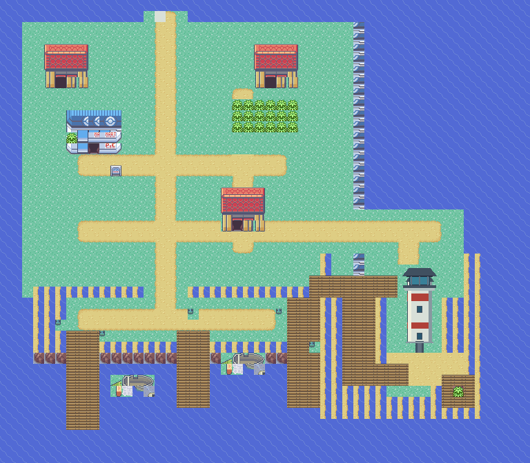
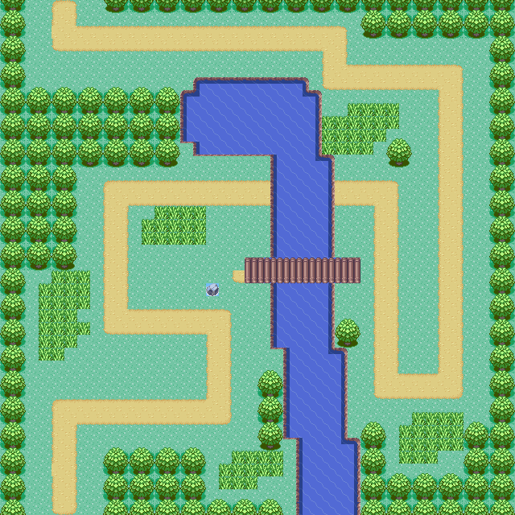

# Chapter 2 — Beneath the Gathering Clouds v0.4

## Scope and baseline

Chapter 2 continues the existing first Gym through Rainfall Pass to Seabreak
Town, ending with the restored lighthouse and reopened harbor. It does not
include the second Gym. The implementation branch is
`codex/virelia-rainfall-seabreak`. The user-confirmed working baseline is
`codex/virelia-prologue` at `492267dadc0f9b54322a39038c479d717eba958a`; the
originally proposed `codex/starter-prologue` is not used to replace this newer
playable work.

The prologue, sanctuary, quarry, first Gym and current regional starter IDs
`1573–1581` remain. Natu → Xatu → Nimbatu stays Water/Psychic. Evolution levels
remain Poochyena 18 / Mightyena 38, Natu 14 / Xatu 34 and Ekans 16 / Arbok 36.
Hoenn story, Link Multi, Duo Adventure and save structures are outside this
chapter's changes. The engine remains `pokeemerald-expansion` 1.17.1 with
Hoenn-compatible Virelia headers; this is not a region-map or Fly rewrite.

The retained My Boy! correction is `debddae9eec8b7f9c88d0e77ce3da605cfba3a04`.
Both compile and release-LTO `-fno-isolate-erroneous-paths-dereference` flags
remain, and ordinary diagnostic mode remains 0. Its recorded Galaxy A26 /
Android 16 / My Boy! 1.8.0 starter-sequence success is historical baseline
evidence, not Android verification of Chapter 2. See [the superseding
compatibility note](MYBOY_COMPATIBILITY.md).

## Complete chapter sequence

1. Earn Mara's existing Lomový odznak. Only
   `FLAG_VIRELIA_FIRST_GYM_COMPLETE` opens Slateford's northern cleft. Mara and
   the passage sign point toward Rainfall Pass and Seabreak. No new badge is
   granted and no trip back to Maplebrook is required.
2. Enter the foothills through the conventional passage at Slateford `(12,1)`.
   The small north-edge patch preserves all other authored city cells and the
   original southern connection to Whisperwood.
3. Choose the short upper bridge trail or the longer lower wetland loop.
   The upper choice has Ranger Irena; the lower choice has Fisherman Dušan,
   stream markings, a Super Potion and the return-footbridge control. Hiker
   Pavel covers the shared foothills. Both alternatives reconnect in lowlands.
4. Meet the opposite-gender rival at lowlands `(15,12)`. Female player meets
   Viktor; male player meets Viktorie. The original starter choice selects the
   established evolved counter-starter. A normal loss whites out; the rival
   remains for retry. A win persists and opens descent tile `(15,13)`.
5. Reach Seabreak and use the combined Center/Mart. Speak to the harbor master
   at `(14,28)` to record the storm closure and missing cargo report.
6. Enter the lighthouse on the eastern rocky headland. Meet Běla Křížová,
   inspect the damaged cabinet at `(5,3)`, and read the emergency instructions
   at `(9,3)`. Běla secures the loose wiring.
7. Take the staircase to the lantern room. Activate the left feed `(3,5)`,
   central lens `(6,5)`, then right signal control `(9,5)`. Clues state this order
   explicitly. A wrong input resets unfinished progress. Completion lights the
   beacon at `(6,2)` and stays saved.
8. Read the shipping record at `(9,8)`. It identifies conductive minerals from
   Slateford Quarry, an illegible recipient stamp and no receipt signature.
   The shipment's purpose and storm's cause remain unresolved.
9. Return to the harbor master. The harbor reopens once; Detective Radim Vacek
   receives public credit while Běla begins questioning his official record.
   The sailor, rival and returning characters update their dialogue. The
   storm-damaged second Gym remains closed, providing the next destination.
10. Continue exploring or return freely through Rainfall, Slateford,
    Whisperwood and Maplebrook. The laboratory remains available as a research
    hub. Professor Javorová, Mara and the player's mother have brief updates.
    Maplebrook's established Ema and her Poochyena retain their identity.

There is no Rocket base or battle in this chapter, no reveal of Porygon,
Giovanni or Storage experiments, and no Hidden Ability or Mega Evolution quest.

## Appended maps and world connections

All coordinates below are zero-based Porymap coordinates. Packed map IDs use
`mapNumber | (groupNumber << 8)`. Layouts 798–806 and sections 212–213 append
after the existing registries. Every new outdoor link uses a conventional
reciprocal warp so the independent rainforest/coastal tilesets cannot corrupt
the old connected-map graphics buffer.

| Map folder suffix after `Virelia_` | Group,map | Packed ID | Layout ID | Size | Weather |
| --- | --- | --- | ---: | --- | --- |
| RainfallFoothills | 75,4 | `0x4B04` | 798 | 32×28 | Sunny |
| RainfallUpper | 75,5 | `0x4B05` | 799 | 32×34 | Rain |
| RainfallLower | 75,6 | `0x4B06` | 800 | 40×40 | Downpour |
| RainfallLowlands | 75,7 | `0x4B07` | 801 | 32×26 | Shade/shelter |
| SeabreakTown | 75,8 | `0x4B08` | 802 | 48×42 | Rain |
| Seabreak_PokemonCenter | 76,8 | `0x4C08` | 803 | 24×9 | None |
| Seabreak_Lighthouse | 76,9 | `0x4C09` | 804 | 16×14 | None |
| Seabreak_LanternRoom | 76,10 | `0x4C0A` | 805 | 13×12 | None |
| Seabreak_KeepersHouse | 76,11 | `0x4C0B` | 806 | 12×10 | None |

`MAPSEC_VIRELIA_RAINFALL_PASS` 212 covers the four route maps;
`MAPSEC_VIRELIA_SEABREAK_TOWN` 213 covers the town and its interiors. Their
nonzero footprints are compatibility metadata, not new Hoenn map artwork or Fly
targets. Existing map groups 75/76, layouts 786–797 and sections 209–211 retain
their IDs.

```text
Slateford north passage
          |
      Foothills --- permanent return shortcut --- Lower control
       /     \
 Upper       Lower wetlands
   \          /
      Lowlands -- rival -- Seabreak
                            |  |  |
                          Center  Keeper's house
                            Lighthouse -- Lantern room
```

The alternative paths stay apart until lowlands. The source graph audit finds
130 walking/warp edges on the upper choice and 153 on the lower choice, from the
foothills arrival to Seabreak's entry with the shortcut closed. These are
shortest-path counts, not measured playtime. The reachable upper grass has 31
cells; the lower has 152. Water remains impassable without Surf, while bridges
and dry banks complete both mandatory paths without any HM.

The lower control at `(18,20)` permanently enables the optional footbridge. It
returns to foothills `(25,23)`; the foothills interaction at `(26,23)` returns
to lower `(17,20)`. The shortcut never depends on an item or temporary puzzle
state.

`tools/virelia/rainfall_contract.json` records dynamic gates, endpoints and the
beacon; the validator compares this metadata with real geometry and scripts.

## Lighthouse and persistent events

The harbor report precedes the damage inspection; the inspection precedes the
three controls. The room's entry resets partial input in temporary variable
`0x400F`. Finished repair uses a saved flag and its load callback restores the
lit beacon. Reading the manifest requires repair; harbor completion requires
both repair and the manifest. Repeated harbor interaction skips the credit scene
after completion.

Normal trainer battles use dedicated victory flags because these appended
opponent IDs exceed the historical system-trainer allocation. The existing
trainer flag base remains fixed. No new field is added to a save block.

| Saved chapter flag | ID |
| --- | --- |
| `FLAG_VIRELIA_RAINFALL_STARTED` | `0x264` |
| `FLAG_VIRELIA_RAINFALL_RIVAL_COMPLETE` | `0x265` |
| `FLAG_VIRELIA_HARBOR_REPORT` | `0x266` |
| `FLAG_VIRELIA_LIGHTHOUSE_DAMAGE` | `0x267` |
| `FLAG_VIRELIA_LIGHTHOUSE_REPAIRED` | `0x268` |
| `FLAG_VIRELIA_SHIPPING_RECORD` | `0x269` |
| `FLAG_VIRELIA_HARBOR_REOPENED` | `0x26A` |
| `FLAG_VIRELIA_RAINFALL_COMPLETE` | `0x26B` |
| `FLAG_VIRELIA_LOWER_SHORTCUT` | `0x26C` |
| `FLAG_VIRELIA_BOTTLE_REWARDED` | `0x26D` |
| `FLAG_VIRELIA_RAINFALL_ITEM_REPEL` | `0x26E` |
| `FLAG_VIRELIA_RAINFALL_ITEM_SUPER_POTION` | `0x26F` |
| `FLAG_VIRELIA_HIDE_VACEK` | `0x270` |
| `FLAG_VIRELIA_HIDE_HARBOR_BELA` | `0x271` |
| `FLAG_VIRELIA_TRAINER_RAINFALL_HIKER` | `0x278` |
| `FLAG_VIRELIA_TRAINER_RAINFALL_RANGER` | `0x279` |
| `FLAG_VIRELIA_TRAINER_RAINFALL_FISHERMAN` | `0x27A` |
| `FLAG_VIRELIA_TRAINER_RAINFALL_WEATHER` | `0x27B` |
| `FLAG_VIRELIA_TRAINER_RAINFALL_RIVAL` | `0x27C` |

Saved `VAR_VIRELIA_BOTTLE_STAGE` is `0x409B`: 0 unstarted, 1 bottle accepted, 2
anchor read, 3 tide mark read, 4 journal found. `VAR_VIRELIA_SIGNAL_INPUT`
`0x400F` is temporary. `0x272–0x277` and `0x27D–0x27F` remain unallocated. The
upper-path Repel uses `0x26E`; the lower-path Super Potion uses `0x26F`.

`FLAG_VIRELIA_FIRST_GYM_COMPLETE` remains `0x3A`; it is read as the
prerequisite, not repurposed. Existing sanctuary, quarry, Missing Tools, badge
and trainer flags retain their allocations. No alias or save migration is
introduced. A structurally matching first-Gym save from the recorded baseline
can continue; prototype saves from earlier species/map arrangements remain
unsupported as recorded in the starter documentation. Back up the original save
and validate with a fresh game if its origin is uncertain. Never load a Chapter
2 map save in a ROM predating these maps.

## Message in the Bottle

The optional quest begins with fisherman Ota at Seabreak `(7,35)`. His family's
argument with the former lighthouse keeper motivates the search. Inspect the old
anchor at `(6,31)`, the coastal tide mark at `(41,35)`, then the journal in the
keeper's house at `(3,3)`. The journal reveals that the keeper left the failed
lamp to guide stranded fishermen to safety. Bring the discovery to Ota for one
Mystic Water. This is local history, unrelated to Rocket cargo.

Clues advance only in order; inspecting later clues early cannot skip a stage.
The saved stage survives leaving and Continue. The reward flag is set only after
`AddBagItem` succeeds, so a full Bag permits retry without duplication. The side
quest and its reward are never required to restore the lighthouse.

## Trainers and battle rewards

All new ordinary parties use conventional single battles, `Check Bad Move` AI, no
held items, and zero deliberate IV bonuses. The source of truth is
`src/data/trainers.party`. Normal prize values below assume the ordinary money
multiplier 1; the engine still applies its existing reward rules.

| Opponent | ID | Area | Party | Ordinary prize |
| --- | ---: | --- | --- | ---: |
| Hiker Pavel | 871 | Foothills | Geodude 16, Makuhita 17 | 680 |
| Ranger Irena | 872 | Upper | Oddish 17, Yanma 18 | 864 |
| Fisherman Dušan | 873 | Lower | Poliwag 17, Marill 18 | 720 |
| Weather enthusiast Milan | 874 | Lowlands | Skiploom 19, Wingull 20 | 320 |

Viktor uses IDs 875–877 and Viktorie 878–880, in original player-choice order
Grass/Water/Fire. Both genders share each matchup's party and ordinary prize
1140. These battles grant no evolutionary item, multiplayer reward or badge.

| Player's original starter | Rival's evolved counter-starter | Supports |
| --- | --- | --- |
| Virelian Poochyena | Virelian Arbok 19 | Taillow 17, Lombre 18 |
| Virelian Natu | Virelian Mightyena 19 | Wingull 17, Geodude 18 |
| Virelian Ekans | Virelian Xatu 19 | Hoppip 17, Aron 18 |

Arbok uses Ember/Acid Spray/Smokescreen/Will-O-Wisp; Mightyena uses Razor
Leaf/Shadow Sneak/Growl/Leech Seed; Xatu uses Water Pulse/Psybeam/Growl/Rain
Dance. The original evolution thresholds are already satisfied at 19. No starter
abilities or stats change. Normal battle loss invokes the existing whiteout
callback; only a recorded win can commit rival completion and remove the coast
blocker.

## Wild encounters

The four native land tables use existing species at levels 14–19. They preserve
the engine's twelve slot weights:20,20,10,10,10,10,5,5,4,4,1,1 percent. The
following tables aggregate repeated species; exact per-slot levels remain in
`src/data/wild_encounters.json`. Encounter rate is an engine parameter, not a
flat per-step percentage. Main walking lanes remain grass-free.

### Foothills — encounter rate 14

| Species | Levels | Total slot weight |
| --- | --- | ---: |
| Geodude | 14–16 | 30% |
| Hoppip | 14–16 | 30% |
| Seedot | 14–16 | 14% |
| Oddish | 14–16 | 10% |
| Shroomish | 15–16 | 9% |
| Taillow | 15–16 | 5% |
| Yanma | 15–16 | 1% |
| Wooper | 15–16 | 1% |

### Upper — encounter rate 16

| Species | Levels | Total slot weight |
| --- | --- | ---: |
| Hoppip | 15–18 | 30% |
| Oddish | 15–18 | 30% |
| Taillow | 15–18 | 10% |
| Shroomish | 15–18 | 10% |
| Wingull | 16–18 | 5% |
| Seedot | 16–18 | 5% |
| Yanma | 16–18 | 5% |
| Lotad | 16–18 | 4% |
| Marill | 16–18 | 1% |

### Lower — encounter rate 19

| Species | Levels | Total slot weight |
| --- | --- | ---: |
| Lotad | 15–19 | 30% |
| Wooper | 15–19 | 25% |
| Poliwag | 15–19 | 15% |
| Oddish | 15–19 | 10% |
| Marill | 15–19 | 14% |
| Hoppip | 16–19 | 4% |
| Yanma | 16–19 | 1% |
| Wingull | 16–19 | 1% |

### Lowlands — encounter rate 14

| Species | Levels | Total slot weight |
| --- | --- | ---: |
| Wingull | 16–19 | 25% |
| Lotad | 16–19 | 21% |
| Marill | 16–19 | 14% |
| Oddish | 16–19 | 14% |
| Wooper | 16–19 | 10% |
| Hoppip | 16–19 | 10% |
| Poliwag | 17–19 | 5% |
| Yanma | 17–19 | 1% |

## Services, weather and balance

Entering the Seabreak Center registers the appended local heal destination.
Teleport's exterior anchor is town `(8,14)`; normal whiteout enters the Center
at `(7,4)` and uses `LOCALID_VIRELIA_SEABREAK_NURSE`. Both exit tiles return to
the town entrance. The local nurse retains the ordinary heal animation and party
restoration while avoiding the uninitialized Union Room name-buffer path. The PC
uses ordinary Pokémon Storage; it is never locked by the plot.

The integrated shop stocks Great Ball, Net Ball, Poké Ball, Potion, Super
Potion, Antidote, Paralyze Heal, Awakening, Repel and Escape Rope. Normal
purchases, sales, saving and loading remain available in the Center.

Weather uses the existing engine: dry rocky foothills, light rain on the upper
route, downpour in the lower wetlands, shaded cliff shelter in lowlands, and
rain in town. Interiors use no weather. No custom particle task, battle weather
engine, weather cycling timer or global performance modification is introduced.
Outdoor rain uses the existing battle-weather behavior, giving all starters an
opportunity to learn about rain through NPCs and opponents.

The shared Natu-family level-up list now teaches Rain Dance at 14, alongside its
established Psybeam. Existing Water Pulse and the level 14 evolution make this a
choice about rain rather than a mandatory new progression ability. Torrent,
Water Absorb, stats and evolution requirements remain unchanged; Storm Omen is
not implemented. Existing saves whose Natu family already passed that level do
not receive a forced move replacement.

The intended progression is 14–17 after Mara, wild 14–19, ordinary trainers
16–20, rival 17–19, and an eventual party around 20–23. These are balance
targets; player party size, skipped trainers and captures affect actual
experience. The upper choice offers fewer wild encounters and the lower offers
more grass, items and exploration. No experience multiplier or forced grind is
added.

The design target is 30–45 additional minutes including exploration and the
optional quest; the bottle quest target is 5–10 minutes. Neither duration is
measured. An unassisted complete playthrough with each starter remains the
appropriate pacing and matchup check; automated state tests do not establish
actual player difficulty or completion time.

## Czech localization and graphics

Every new scripted message, prompt and trainer introduction is Czech with
preserved diacritics. Place names, species names, item names and move names
retain their established English spelling. Existing localized battle, shop,
Storage, evolution and save interfaces remain in use. The bounded localization
manifest now covers obtainable data through level 24, including new wild
species, trainer parties, evolutions, abilities, held items and level-up moves.
The actual Normal-font dialogue limit is 208 px in the 240×160 viewport; script
validation also checks glyphs, expanded player/rival names and two-line pages.

The new route bank derives from stock Fortree rainforest art and General
rock/ground/water art. It uses distinct authored geography rather than copying
Route119's layout. Coastal graphics pack existing Slateport harbor parts and
General houses with small native-pixel boardwalk, tower and equipment additions.
The new lighthouse interior bank clones ordinary Building/GenericBuilding
furnishings and supplies safe secondary warp metatiles. Donor banks and the old
shared `VireliaOutdoor` bank are unchanged.

Běla uses the stock `WOMAN_2` field sprite; Vacek uses `POLICEMAN`; the harbor
master and workers use stock sailor/fisherman sprites, and the reporter uses
`REPORTER_F`. These are character-art placeholders. The lighthouse tower and
plain cabinet/beacon graphics are prototype native-pixel assets. Boats reuse
stock harbor fragments and are scenery, not vehicles. Seabreak's closed Gym plot
uses a storm-inspection board rather than a playable Gym interior.

`tools/virelia/build_rainfall_seabreak.py` regenerates only Chapter 2 assets and
the documented north-passage footprint. Future Porymap edits to those new maps
must be preserved before regeneration. Do not run the older world or first-Gym
map generators to update this chapter. `tools/virelia/render_rainfall.py`
produces map/tileset inspection PNGs under `outputs/rainfall/`; those static
renders do not substitute for controller or emulator evidence.





## Verification record

The source graph audit passes on 2026-10-27: 3,717 reachable tiles across the
old city and nine new maps; both independent no-HM choices; reciprocal native
warp triggers; event/counter approaches; trainer sight lines; badge and rival
gates; persistent shortcut endpoints; four encounter tables; all six rival
variants; Center/heal/PC/shop configuration; retained old IDs/geometry and My
Boy flags. The first-Gym and original-world source audits also pass after
narrowly allowing the appended map-registry suffix and the new city warp.

The Czech validator passes with 1,748 manifest entries and level bound 24,
including every new map/shared dialogue's glyphs, widths and pages. Its local
record is `outputs/rainfall/localization-check.json`. This is a source-text
result, not a full native UI playthrough.

Native tests in `test/virelia_rainfall_events.c` exercise compiled event
helpers, all six actual rival loss/win callbacks, puzzle restoration, route gate
reload, full-Bag reward retry, services, dedicated trainer flags and six FLASH
story checkpoints. Build and runtime outcomes are recorded below when completed.

| Evidence | Status / artifact |
| --- | --- |
| Source map/story/service audit | PASS, `python3 tools/validate_virelia_rainfall.py` |
| Czech source/font/coverage audit | PASS, 1,748 entries through 24 |
| Optimized Emerald release compilation | Pending current build; log `outputs/rainfall/release-build.log` |
| Native event and FLASH suite | Pending execution |
| Native controller-driven chapter checks | Pending execution |
| Exact-commit GitHub Actions workflow | Pending pushed-branch run |
| Android/My Boy! chapter playthrough | NOT TESTED |
| Unassisted full chapter timing/all-starter balance | NOT MEASURED |

Reproduce source checks and the targeted native suite from the repository root:

```sh
python3 tools/validate_virelia_rainfall.py
python3 tools/validate_virelia_world.py
python3 tools/validate_virelia_first_gym.py
python3 tools/validate_virelia_sanctuary.py
python3 tools/validate_virelia_prologue_text.py
python3 .github/docs_validate/inclusive_summary.py
make -j4 check TESTS="Rainfall"
```

Run the existing `CI` workflow on the exact milestone commit for Emerald
development/release, FireRed, LeafGreen, full native tests, development-mode
regressions and documentation validation. Preserve the ordinary My Boy flags.
The working-agreement commands `npm format` and `npm lint` were attempted;
this C/Makefile checkout has no `package.json`, and `npm` is absent from PATH.
No production dependency was added.

## Manual Android / My Boy! checklist

Record the milestone commit, CI run/artifact, ROM SHA-256, Android
model/version, My Boy! version, BIOS mode and starting save for every attempt.
Use a backed-up first-Gym save from the recorded baseline, then repeat with a
new game. Use ordinary in-game Save and a fresh emulator launch/Continue; save
states alone do not validate FLASH persistence.

- Before Mara, check the northern exit remains blocked. After victory, read
  Mara's hint and enter Rainfall. Return immediately to Slateford and verify
  the existing quarry, sanctuary, Maplebrook and lab remain usable.
- Walk the entire upper choice, narrow bridges and all entrances in both
  directions. Repeat the lower choice, stream banks, optional item and
  shortcut. Confirm collisions, elevations, camera borders and trainer sight.
- Compare rainy, downpour, sheltered and indoor transitions. Save in each
  route zone, restart and move/interact after Continue. Observe performance
  during extended rain on the actual Android device.
- Test both player genders and all three starter choices. Lose to the rival,
  verify normal whiteout and safe retry, then win. Restart and confirm the
  rival battle cannot repeat and the coastal descent stays open.
- Enter the Center before a later loss, verify the local whiteout destination,
  heal damaged/statused Pokémon, buy/sell items, deposit/withdraw a Pokémon,
  save indoors and restart from FLASH. Check Czech service messages visually.
- Save after the harbor report and after damage inspection. Try controls
  before inspection, cancel choices, press an incorrect order, leave midway,
  then solve feed/lens/beacon. Save/restart before and after repair; confirm
  only completed repair stays lit and all controls remain accessible.
- Read the manifest, save before returning to the harbor, then finish the
  credit scene. Save/restart and revisit all harbor characters. Confirm the
  scene does not repeat, the harbor dialogue changes and the Gym stays closed.
- Start the bottle quest, inspect clues out of order, then follow both coastal
  clues and the keeper journal. Save/restart at each stage. Fill the relevant
  Bag pocket before claiming Mystic Water, clear space and retry; claim only
  one reward. Revisit Ota after another restart.
- Review Czech accents, widths, battle titles, new species summaries, moves,
  abilities, items and reachable evolutions through 24 on the 240×160 display.
- Repeat the full journey with each starter family and record actual party
  levels, losses, optional content and elapsed playtime. Record any grind,
  forced type disadvantage, unexpected stall or unusual weather slowdown.

A successful mGBA/CI result must not be marked as a My Boy! pass. The historical
Galaxy A 26 starter check remains separate from this chapter's Android
checklist.

## Known limitations

The second Gym and future route are intentionally unavailable. There is no
separate Virelia Town Map, Fly network or full two-region engine. Character and
some equipment art remain the placeholders listed above. Lighthouse completion
changes the beacon and harbor events; the town's rain is intentionally not
removed, because the storm has not been established as artificial. Boats do not
depart under player control. Multiplayer rewards, Hidden Ability unlocks, Mega
Evolution and the later Rocket plot remain outside this milestone.
